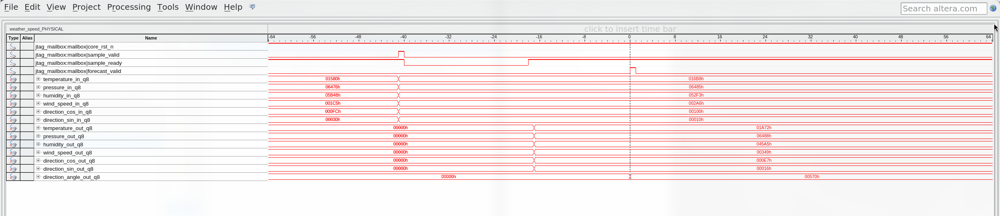

# Run the weather forecasting design on the DE2 FPGA

Operating procedure WS-DE2-01  
Revision 1 · 2 November 2026  
Target: original Terasic DE2, Cyclone II EP2C35F672C6  
Software baseline: Quartus II Web Edition 13.0 SP1

## Purpose and completion criteria

Use this procedure to program the speed-oriented weather predictor, send its supplied test observations through USB-Blaster, check the returned forecasts, and record a live SignalTap waveform. It also covers rebuilding the two required programming files and locating the compilation results in Quartus.

The instructions assume no knowledge of the forecasting code. They use the existing trained model and replay vectors. Training a new model is unnecessary for this demonstration.

A completed reproduction has these records:

| Record | Required result |
| --- | --- |
| Device detection | EP2C35 with JTAG ID `020B40DD` |
| Ordinary JTAG replay | `PASS PHYSICAL JTAG weather_speed: inputs=128 forecasts=104` |
| Replay CSV | 128 rows; 24 warm-up rows and 104 matching forecasts |
| Instrumented replay | The same 128-input and 104-forecast check with the SignalTap build |
| Live acquisition | A saved `.stp` containing actual acquired data, with input and output matching the supplied reference transaction |
| Compilation evidence, if rebuilding | Successful fit and timing results from the ordinary JTAG project |

The terminal displays the forecasts. Quartus can display the saved result word and the waveform. This design does not drive a forecast onto LEDs, seven-segment displays, or the LCD.

The primary procedure is for Linux with Bash, matching the computer used for the retained hardware tests. Quartus menu operations are described separately where useful. Windows installation, driver setup, and command-shell syntax have not been validated by this procedure.

## Contents

1. [Prepare the equipment and project](#1-prepare-the-equipment-and-project)
2. [Prepare a terminal and a new results folder](#2-prepare-a-terminal-and-a-new-results-folder)
3. [Connect and identify the DE2](#3-connect-and-identify-the-de2)
4. [Obtain the programming files](#4-obtain-the-programming-files)
5. [Program and test the ordinary design](#5-program-and-test-the-ordinary-design)
6. [Inspect the returned forecasts](#6-inspect-the-returned-forecasts)
7. [Capture a live SignalTap waveform](#7-capture-a-live-signaltap-waveform)
8. [Validate and display the capture](#8-validate-and-display-the-capture)
9. [Collect synthesis and timing evidence](#9-collect-synthesis-and-timing-evidence)
10. [Save the demonstration record](#10-save-the-demonstration-record)
11. [Recover from common failures](#11-recover-from-common-failures)
12. [Run the defense demonstration](#12-run-the-defense-demonstration)

Appendices list the files, define the result fields, and identify the supporting records.

## 1 Prepare the equipment and project

### 1.1 Check the hardware

Have the following equipment available before starting:

- An original DE2 board fitted with **EP2C35F672C6**.
- Its suitable external power supply.
- A USB cable connected to the board's USB-Blaster programming connection.
- A Linux computer with the project files and working Quartus installation.

Read the FPGA marking or confirm the board identity before programming. A DE2-115, DE2-70, or another Cyclone II board is a different target. These programming files and pin assignments are for the original DE2.

USB-Blaster carries both programming and the JTAG sample interface. No RS-232 cable or UART adapter is needed. No weather sensor is needed because the demonstration replays observations from a file.

### 1.2 Check the software

Use Quartus II Web Edition **13.0 SP1**, with Cyclone II device support and the Programmer and SignalTap tools installed. The retained logs identify version **13.0.1 Build 232**. Use the same version when reproducing the saved compilation results.

The procedure requires `quartus_sh`, `quartus_pgm`, `quartus_stp`, `jtagconfig`, and Python 3. A text editor and a screenshot tool are useful. ModelSim, Verilator, a C++ compiler, NumPy, and an internet connection are not needed when the supplied vectors and programming files are already available.

On a newly prepared computer, install the vendor USB-Blaster driver or Linux device-access rules before the rehearsal. Use the vendor installation guide linked in Appendix C. Resolve tool startup and driver problems before the defense; programming the board does not require retraining the model.

### 1.3 Obtain a complete project copy

Copy the **whole `fpga-temp-predictor` directory** to the demonstration computer. Preserve its internal directory structure. Project source paths are relative to their Quartus project directories.

A Git clone can omit generated files. In particular, `.sof` programming files, `output_files/`, and several `build/` directories are ignored by this repository. The tracked replay file is `hardware/jtag/vectors/weather.txt`; retain it unchanged. If a required generated file is missing, follow Section 4 rather than substituting a similarly named file from another project.

If using the original computer, the project root is:

```text
/home/khoale/Documents/University/Semester_5/CE436_Discrete-Time_Signal_Processing/fpga-temp-predictor
```

## 2 Prepare a terminal and a new results folder

Use one terminal for setup and replay. A second terminal will be needed only during waveform acquisition.

1. Open a Bash terminal and change to the project root:

   ```bash
   cd '/home/khoale/Documents/University/Semester_5/CE436_Discrete-Time_Signal_Processing/fpga-temp-predictor'
   ```

   On another computer, replace the quoted path with that computer's full path to `fpga-temp-predictor`. Do not change to `docs/` or to a Quartus subdirectory.

2. Set the project and Quartus locations:

   ```bash
   export PROJECT_ROOT="$PWD"
   export QUARTUS_BIN='/home/khoale/altera/13.0sp1/quartus/bin'
   export PATH="$QUARTUS_BIN:$PATH"
   ```

   Replace `QUARTUS_BIN` if Quartus is installed elsewhere. It must identify the directory containing the Quartus executables. These settings apply to this terminal; they do not edit system configuration.

3. Check the available tools:

   ```bash
   command -v quartus_sh quartus_pgm quartus_stp jtagconfig python3
   quartus_sh --version
   ```

   Each requested command must resolve to an executable. Confirm that the Quartus version is 13.0 SP1. If a command is missing, correct the installation path before continuing.

4. Create a separate folder for this reproduction:

   ```bash
   export RUN_DIR="$PROJECT_ROOT/docs/reports/reproduction_weather_speed/$(date +%Y%m%d_%H%M%S)"
   mkdir -p "$RUN_DIR"
   printf '%s\n' "$RUN_DIR"
   ```

   Keep the printed path. Use this same folder throughout the session. A later run should get a new folder, so its results do not replace a previous demonstration.

5. Record the tool version:

   ```bash
   quartus_sh --version > "$RUN_DIR/quartus_version.txt" 2>&1
   ```

6. Enable pipeline error reporting:

   ```bash
   set -o pipefail
   ```

   Several commands below use `tee` to display output and save it. With this setting, an error from Quartus remains an error even if `tee` successfully writes the log.

Text in a `bash` block is entered in the terminal. Text in a `text` block shows an expected message, a filename, or a sample output; do not enter those blocks as commands.

## 3 Connect and identify the DE2

### 3.1 Connect the board

1. With board power off, set the RUN/PROG switch to **RUN** for JTAG programming. Consult the original-DE2 manual if the labels or switch location are unclear.
2. Connect the board's external power supply.
3. Connect the USB-Blaster programming connection to the computer. Use the connection labelled for USB-Blaster, rather than a USB host or peripheral port.
4. Switch the board on and check its power indicator.
5. Release KEY0. The application uses KEY0 as an active-low reset input; holding it down prevents normal replay.

An existing factory demonstration or an older design may light the displays. That does not identify which forecasting design is loaded. The next programming step replaces the volatile FPGA configuration.

### 3.2 Check the chain

1. In the setup terminal, run:

   ```bash
   jtagconfig 2>&1 | tee "$RUN_DIR/jtagconfig.txt"
   ```

2. Find the USB-Blaster entry and the device below it. The original session showed:

   ```text
   1) USB-Blaster [1-1]
     020B40DD   EP2C35 (IR=10)
   ```

   The USB address and cable number can differ. The FPGA must be EP2C35 with ID `020B40DD`.

3. If exactly one cable and one EP2C35 are connected, record its cable number. The commands below use cable **1**. Replace that argument if your cable has another number.

4. If the cable appears without the FPGA, stop and follow Section 11.2. If no cable appears, use Section 11.1. Do not continue to replay until the device is visible.

The fitted JTAG timing constraint assumes a 10 MHz TCK. If the cable exposes an adjustable JTAG clock setting, use 10 MHz or lower. The application clock remains the board's 50 MHz clock.

## 4 Obtain the programming files

Two different FPGA configurations are used in this procedure.

| Purpose | Quartus project | Programming file |
| --- | --- | --- |
| Resource/timing measurements and normal replay | `versions/weather_v2/quartus/de2_jtag_speed/weather_jtag.qpf` | `versions/weather_v2/quartus/de2_jtag_speed/output_files/weather_jtag.sof` |
| Live waveform acquisition | `hardware/quartus/signaltap/weather_speed/capture.qpf` | `hardware/quartus/signaltap/weather_speed/output_files/capture.sof` |

A `.qpf` opens a Quartus project. Its `.qsf` stores device, source, and pin assignments. A `.sof` is the file programmed into the FPGA. A `.stp` stores the SignalTap setup and, after acquisition, captured data.

The ordinary and instrumented builds execute the same speed-oriented weather system, but the latter also contains capture hardware. Use ordinary-build reports for the reported resource comparison. Use the instrumented build for live SignalTap acquisition.

### 4.1 Use the existing files

From the project root, check for both files:

```bash
ls -l versions/weather_v2/quartus/de2_jtag_speed/output_files/weather_jtag.sof
ls -l hardware/quartus/signaltap/weather_speed/output_files/capture.sof
ls -l hardware/jtag/vectors/weather.txt
```

If all files exist and belong to the handed-over project, continue to Section 5. Record their hashes:

```bash
sha256sum \
  versions/weather_v2/quartus/de2_jtag_speed/output_files/weather_jtag.sof \
  hardware/quartus/signaltap/weather_speed/output_files/capture.sof \
  hardware/jtag/vectors/weather.txt \
  > "$RUN_DIR/input_files.sha256"
```

Do not select `versions/weather_v2/quartus/de2_jtag_resource/`, `de2_speed/`, or `quartus/speed/`. Those identify the shared JTAG design, the UART wrapper, and a core-only measurement project respectively.

### 4.2 Restore missing files from the retained archive

The retained archive contains both weather speed programming files and the SignalTap project. Restore into a temporary location first so existing project files are not replaced.

1. Confirm that the archive is available:

   ```bash
   ls -l docs/reports/defense_evidence_2026-10-28.tar.gz
   ```

2. Extract it under this run's folder:

   ```bash
   mkdir -p "$RUN_DIR/archive_restore"
   tar -xzf docs/reports/defense_evidence_2026-10-28.tar.gz \
     -C "$RUN_DIR/archive_restore"
   ```

3. Restore the ordinary programming file **only if its destination is missing**:

   ```bash
   mkdir -p versions/weather_v2/quartus/de2_jtag_speed/output_files
   cp -n \
     "$RUN_DIR/archive_restore/versions/weather_v2/quartus/de2_jtag_speed/output_files/weather_jtag.sof" \
     versions/weather_v2/quartus/de2_jtag_speed/output_files/weather_jtag.sof
   ```

4. Restore the capture project directory if it is missing, or ask the project owner to provide its complete directory. The archive's source is:

   ```text
   archive_restore/hardware/quartus/signaltap/weather_speed/
   ```

   This directory contains the project and matching `capture.stp` and `capture.sof`. It does not replace the need for the rest of the repository's RTL sources.

5. Repeat Section 4.1 and record the hashes after restoration.

The archive is historical evidence. Extracting an old CSV or waveform does not constitute a new physical run. New evidence is produced by Sections 5 through 8.

### 4.3 Rebuild the ordinary design if required

Use this route when the ordinary SOF is unavailable, source changes must be included, or the defense requires a fresh compilation.

1. In Quartus, select File > Open Project and open:

   ```text
   versions/weather_v2/quartus/de2_jtag_speed/weather_jtag.qpf
   ```

2. Check Assignments > Device. The selected device must be **EP2C35F672C6**.
3. Check the project hierarchy or settings for top-level entity **de2_weather_jtag**, revision **weather_jtag**, and parameter **SHARED = 0**.
4. Check the Pin Planner or assignment file. The application pins are `CLOCK_50 = PIN_N2` and `KEY0_N = PIN_G26`. The source clock constraint is 20 ns. JTAG uses the device's dedicated programming infrastructure.
5. Select Processing > Start Compilation. Wait for successful completion. Review any errors or critical warnings before using the output file.
6. Confirm that the generated programming file is in this project's `output_files/` directory.

For a terminal compilation from the project root, use the equivalent command:

```bash
(
  cd versions/weather_v2/quartus/de2_jtag_speed
  quartus_sh --flow compile weather_jtag
) 2>&1 | tee "$RUN_DIR/ordinary_compile.log"
```

The parentheses keep the surrounding terminal in the project root. Do not run the GUI and terminal compilation of the same project at the same time.

### 4.4 Rebuild the instrumented design if required

1. Open `hardware/quartus/signaltap/weather_speed/capture.qpf` in Quartus.
2. Confirm the same EP2C35F672C6 device and `SHARED = 0`. The revision is **capture**.
3. Confirm that `capture.stp` is the project's enabled SignalTap file.
4. Select Processing > Start Compilation.
5. Inspect the Analysis & Synthesis messages or `output_files/capture.map.rpt`. The retained build contains `Succesfully connected in-system debug instance` (including that spelling). Investigate disconnected or missing SignalTap-node warnings, including Critical Warning 35025.
6. Use the newly generated `output_files/capture.sof` together with that build's `capture.stp`.

Terminal alternative:

```bash
(
  cd hardware/quartus/signaltap/weather_speed
  quartus_sh --flow compile capture
) 2>&1 | tee "$RUN_DIR/capture_compile.log"
```

Keep the instrumentation configuration unchanged for this reproduction. Adding probes, changing acquisition settings, or regenerating the capture project can require recompilation. `scripts/prepare_signaltap.py weather_speed` regenerates project files; it is not part of the normal demonstration procedure.

## 5 Program and test the ordinary design

### 5.1 Program through Quartus

1. Open the ordinary JTAG project from Section 4.
2. Select Tools > Programmer.
3. Select Hardware Setup and choose the USB-Blaster identified in Section 3.
4. Select **JTAG** mode.
5. Remove any unrelated programming-file entry from the Programmer list. Use Add File to select the ordinary weather speed `weather_jtag.sof` from Section 4. Verify its full path.
6. Enable **Program/Configure** for the EP2C35 and select Start.
7. Wait for successful completion. Save a screenshot showing the device, programming file, and completed operation.

Removing a row from the Programmer list only changes the list; it does not delete the SOF from disk.

### 5.2 Program from the terminal instead

Use this method when a saved programming transcript is preferred. It programs the same configuration as Section 5.1; running both methods is unnecessary.

```bash
quartus_pgm -m jtag -c 1 \
  -o "p;$PROJECT_ROOT/versions/weather_v2/quartus/de2_jtag_speed/output_files/weather_jtag.sof" \
  2>&1 | tee "$RUN_DIR/ordinary_programming.log"
```

Replace cable number `1` if necessary. A successful retained run includes:

```text
Configuration succeeded -- 1 device(s) configured
Successfully performed operation(s)
```

A failed programming operation is not corrected by running the replay again. Resolve the programming error first.

### 5.3 Replay the test observations

1. Release KEY0 and leave the board powered.
2. Stop any manual writes in the In-System Sources and Probes Editor. Do not operate its source controls while the script is running.
3. In the setup terminal, run:

   ```bash
   FPGA_JTAG_CSV="$RUN_DIR/ordinary_replay.csv" \
     quartus_stp -t scripts/replay_jtag.tcl weather_speed \
     2>&1 | tee "$RUN_DIR/ordinary_replay.log"
   ```

4. Check the detected variant and source/probe node near the start of the output:

   ```text
   Variant: weather_speed
   Node: {0 128 256 FCST}
   ```

   The hardware and device strings will identify the selected cable and EP2C35. The script checks the design signature and shared-architecture flag before sending inputs.

5. Wait for the final success line:

   ```text
   PASS PHYSICAL JTAG weather_speed: inputs=128 forecasts=104; CSV=...
   ```

6. Confirm that `ordinary_replay.csv` exists in `RUN_DIR`. Continue to Section 6.

`FPGA_JTAG_CSV` changes the output location for this command. Without it, the existing script writes `docs/reports/physical_jtag_weather_speed.csv`, replacing that file's previous contents. Use the override in this procedure to preserve earlier evidence.

If several cables or devices are connected, the replay script stops rather than choosing one silently. Supply their exact Quartus names as its second and third arguments. For example, with the names from the retained session:

```bash
FPGA_JTAG_CSV="$RUN_DIR/ordinary_replay.csv" \
  quartus_stp -t scripts/replay_jtag.tcl weather_speed \
  'USB-Blaster [1-1]' '@1: EP2C35 (0x020B40DD)' \
  2>&1 | tee "$RUN_DIR/ordinary_replay.log"
```

Replace both names with those shown for the connected hardware. Keep the quotation marks, including around brackets and spaces.

## 6 Inspect the returned forecasts

### 6.1 Read one result

The script prints seven forecast values in this order:

| Position | Value | Unit |
| --- | --- | --- |
| 1 | Temperature | °C |
| 2 | Surface pressure | kPa |
| 3 | Relative humidity | % |
| 4 | Wind speed | m/s |
| 5 | Direction cosine | Dimensionless |
| 6 | Direction sine | Dimensionless |
| 7 | Wind direction angle | Degrees |

With the supplied vectors, the retained first result was:

```text
sample=24 forecast=26.445312 100.531250 69.644531 3.285156 0.902344 0.085938 5.437500 match=True
```

`sample=24` is a zero-based index, so this is the **25th accepted frame**. The first 24 accepted frames fill history. Each following frame produces a forecast, giving 128 − 24 = 104 results.

These seven values include cosine and sine as diagnostic outputs. They describe five weather quantities. The frame represents recorded observations; its three-hour forecast horizon does not require a three-hour wait during replay.

### 6.2 Check the CSV counts

Run the following check in the same terminal. It reads the new CSV and saves a short summary; it does not communicate with the board.

```bash
python3 - <<'PY' | tee "$RUN_DIR/ordinary_csv_check.txt"
import csv
import os
from pathlib import Path

path = Path(os.environ['RUN_DIR']) / 'ordinary_replay.csv'
with path.open(newline='') as stream:
    rows = list(csv.DictReader(stream))
assert len(rows) == 128, f'Expected 128 rows, got {len(rows)}'
for index, row in enumerate(rows):
    assert int(row['sample_index']) == index
    assert int(row['accepted_count']) == index + 1
    assert int(row['forecast_count']) == max(0, index - 23)
    expected = 'warmup' if index < 24 else 'True'
    assert row['match'] == expected, (index, row['match'])
print('PASS CSV: 128 inputs, 24 warm-up rows, 104 matching forecasts')
print('First forecast:', rows[24]['forecast_physical'])
print('Last forecast: ', rows[-1]['forecast_physical'])
print('CSV:', path)
PY
```

If the check raises an assertion, keep the failed CSV and log. Use Section 11 instead of editing the file to make the counts agree.

### 6.3 Inspect the persistent result in Quartus

1. Wait until replay has finished.
2. Open Tools > In-System Sources and Probes Editor.
3. Select the USB-Blaster and EP2C35, then scan or refresh the instance list.
4. Select **FCST**, instance index **0**. Its source width is 128 bits and probe width is 256 bits.
5. Read the probe data in hexadecimal. Do not write new source data during this inspection.
6. Save a screenshot with the instance identity and probe value visible.

The probe preserves the most recent forecast until another forecast or reset. Its counters should read 128 accepted inputs and 104 forecasts after a complete replay. Appendix B describes the bit fields if a manual decode is required. For readable physical units, use the CSV rather than reading a 256-bit hexadecimal word during the presentation.

## 7 Capture a live SignalTap waveform

This section records a new acquisition in the new results folder. It avoids the existing `run_signaltap_capture.py` wrapper because that wrapper saves into the historical `defense_session` directory.

### 7.1 Program the instrumented build

1. Finish the ordinary replay and close the In-System Sources and Probes Editor.
2. Program the instrumented SOF:

   ```bash
   quartus_pgm -m jtag -c 1 \
     -o "p;$PROJECT_ROOT/hardware/quartus/signaltap/weather_speed/output_files/capture.sof" \
     2>&1 | tee "$RUN_DIR/capture_programming.log"
   ```

3. Confirm successful configuration. The ordinary replay may still work on this build, but SignalTap acquisition is available only with the instrumented configuration.
4. Copy its matching SignalTap setup into the new results folder:

   ```bash
   cp hardware/quartus/signaltap/weather_speed/capture.stp \
     "$RUN_DIR/weather_speed_live.stp"
   ```

### 7.2 Select the live hardware in SignalTap

1. In Quartus, open `hardware/quartus/signaltap/weather_speed/capture.qpf`.
2. Open Tools > SignalTap II Logic Analyzer. Open the copied `weather_speed_live.stp` from `RUN_DIR`.
3. In the JTAG Chain Configuration area, select the connected USB-Blaster and the EP2C35 device. The supplied setup contains the cable name from the original session, which can differ on another computer.
4. If the programming-file field needs correction because the STP was copied, browse to the full path of `hardware/quartus/signaltap/weather_speed/output_files/capture.sof`.
5. Check the acquisition setup without changing it: instance `auto_signaltap_0`, clock `CLOCK_50`, depth **512**, center trigger position, and rising-edge trigger on `jtag_mailbox:mailbox|forecast_valid`.
6. Save the copied STP. Close the SignalTap window before starting the scripted capture below. Leave the FPGA powered and programmed.

If the analyzer reports a configuration or instance mismatch, do not change probes to silence it. Recheck the SOF/STP pairing. The acquisition setup must match the hardware that was compiled.

### 7.3 Prepare the capture command

The small Tcl file below calls the same Quartus acquisition API used by the retained capture script, but saves to this session's STP. It changes no project source or original evidence file.

In the setup terminal, create it:

```bash
cat > "$RUN_DIR/acquire_weather_speed.tcl" <<'TCL'
package require ::quartus::stp
set args $quartus(args)
if {[llength $args] != 1} {
    error "Usage: acquire_weather_speed.tcl /full/path/to/weather_speed_live.stp"
}
set capture_file [file normalize [lindex $args 0]]
open_session -name $capture_file
puts "CAPTURE ARMED: send the weather_speed replay from the second terminal now"
flush stdout
run -instance auto_signaltap_0 \
    -signal_set signal_set_1 \
    -trigger trigger_1 \
    -data_log live_capture \
    -timeout 120
close_session
puts "CAPTURE SAVED: $capture_file"
TCL
```

The command waits up to 120 seconds for a trigger. Prepare the second terminal before starting it.

### 7.4 Prepare the replay terminal

1. Open a second Bash terminal.
2. Change to the same project root used in Section 2.
3. Set its environment. Copy the actual `RUN_DIR` printed in Section 2 into the last line:

   ```bash
   export PROJECT_ROOT="$PWD"
   export QUARTUS_BIN='/home/khoale/altera/13.0sp1/quartus/bin'
   export PATH="$QUARTUS_BIN:$PATH"
   export RUN_DIR='/replace/with/the/existing/run/folder'
   set -o pipefail
   ```

   Correct `QUARTUS_BIN` on another installation. Do not create a new run folder here.

4. Confirm that both terminals point to the same copied setup:

   ```bash
   ls -l "$RUN_DIR/weather_speed_live.stp"
   ```

### 7.5 Acquire while replay runs

1. In the **first terminal**, start acquisition:

   ```bash
   quartus_stp -t "$RUN_DIR/acquire_weather_speed.tcl" \
     "$RUN_DIR/weather_speed_live.stp" \
     2>&1 | tee "$RUN_DIR/capture_acquisition.log"
   ```

2. Watch for the armed message and for SignalTap to enter the pre-trigger acquisition state. The retained Quartus log describes this as `PRE`. The terminal remains occupied while acquisition waits.
3. In the **second terminal**, promptly start the replay:

   ```bash
   FPGA_JTAG_CSV="$RUN_DIR/capture_replay.csv" \
     quartus_stp -t scripts/replay_jtag.tcl weather_speed \
     2>&1 | tee "$RUN_DIR/capture_replay.log"
   ```

4. Wait for replay to report `PASS PHYSICAL JTAG weather_speed: inputs=128 forecasts=104`.
5. Return to the first terminal. Confirm that acquisition reached `DONE` and printed `CAPTURE SAVED` with the new STP path.
6. If acquisition times out, stop the attempt and repeat this subsection after checking the programmed SOF and trigger setup. A successful replay without acquired data does not constitute a waveform capture.

Use the explicit hardware/device arguments from Section 5.3 if multiple devices are connected. Select the same cable and device in the SignalTap setup. Do not run two replays at once. The capture process and one replay process can run together because they address the SignalTap and source/probe facilities respectively; this is the arrangement used in the retained physical session.

## 8 Validate and display the capture

### 8.1 Check that the STP contains acquired data

The following check reads the new acquisition, decodes its buses, and compares the captured transaction with the first forecast-producing supplied vector. It writes a decoded CSV into `RUN_DIR`.

Run it from the project root in either terminal after acquisition has ended:

```bash
python3 - <<'PY' | tee "$RUN_DIR/capture_check.txt"
import csv
import os
import xml.etree.ElementTree as ET
from pathlib import Path

run_dir = Path(os.environ['RUN_DIR'])
path = run_dir / 'weather_speed_live.stp'
root = ET.parse(path).getroot()
signal_set = root.find('instance/signal_set')
assert signal_set is not None, 'SignalTap signal set is missing'
data = signal_set.find('trigger/log/data')
assert data is not None, 'No acquired data is saved in this STP'
count = int(data.get('sample_depth', '-1'))
trigger = int(data.get('trigger_position', '-1'))
names = [wire.get('name') for wire in
         signal_set.find('signal_vec/data_input_vec')]
bits = ''.join((data.text or '').split())
assert count == 512, ('Unexpected depth', count)
assert trigger == 256, ('Unexpected center trigger', trigger)
assert len(bits) == count * len(names), 'Acquisition data length is wrong'
assert set(bits) <= {'0', '1'}, 'Acquisition contains nonbinary data'
rows = [bits[i * len(names):(i + 1) * len(names)] for i in range(count)]
prefix = 'jtag_mailbox:mailbox|'
positions = {name: index for index, name in enumerate(names)}

def bit(index, name):
    return int(rows[index][positions[prefix + name]])

def bus(index, name, width):
    return sum(bit(index, f'{name}[{b}]') << b for b in range(width))

accepts = [i for i in range(count)
           if bit(i, 'sample_valid') and bit(i, 'sample_ready')]
valids = [i for i in range(count) if bit(i, 'forecast_valid')]
assert len(accepts) == 1 and len(valids) == 1, (accepts, valids)
assert all(bit(i, 'core_rst_n') for i in range(count))
accept, valid = accepts[0], valids[0]
assert valid - accept == 41, ('Unexpected capture separation', accept, valid)
vector_path = Path('hardware/jtag/vectors/weather.txt')
fields = vector_path.read_text().splitlines()[24].split()
expected_input = (int(fields[1], 16) >> 2) & ((1 << 108) - 1)
expected_output = int(fields[4], 16)
actual_input = bus(accept, 'sample_data', 108)
actual_output = bus(valid, 'forecast_data', 126)
assert actual_input == expected_input, 'Captured input differs from vector 25'
assert (actual_output & ((1 << 108) - 1)) == \
       (expected_output & ((1 << 108) - 1)), 'Forecast component mismatch'
angle = actual_output >> 108
expected_angle = expected_output >> 108
delta = abs(angle - expected_angle)
delta = min(delta, 92160 - delta)
assert delta <= 5, ('Direction tolerance exceeded', delta)
output = run_dir / 'weather_speed_live_decoded.csv'
with output.open('w', newline='') as stream:
    writer = csv.writer(stream)
    writer.writerow(['capture_index', 'relative_to_trigger', 'time_ns',
                     'core_rst_n', 'sample_valid', 'sample_ready',
                     'forecast_valid', 'sample_data_hex', 'forecast_data_hex'])
    for i in range(count):
        writer.writerow([i, i - trigger, (i - trigger) * 20,
                         bit(i, 'core_rst_n'), bit(i, 'sample_valid'),
                         bit(i, 'sample_ready'), bit(i, 'forecast_valid'),
                         hex(bus(i, 'sample_data', 108)),
                         hex(bus(i, 'forecast_data', 126))])
print('PASS CAPTURE: 512 samples; input and forecast match the reference')
print('Accepted input index:', accept)
print('Forecast-valid index:', valid)
print('Raw sample separation:', valid - accept)
print('Forecast word:', hex(actual_output))
print('Decoded CSV:', output)
PY
```

For the retained setup and vectors, expected indices are 215 for acceptance and 256 for forecast-valid. The raw separation is **41 acquisition samples**. The documented RTL latency is **40 cycles**, measured by observing updated registers after an accepting edge. SignalTap samples values at its acquisition edge, giving the one-sample difference under these conventions. Preserve both descriptions when presenting the result.

A failed check should be investigated. Changes to trigger position, probes, vectors, or RTL invalidate this exact reproduction check and should be recorded as a different experiment.

### 8.2 Display the saved waveform in Quartus

1. Wait for both terminal commands to finish.
2. Open SignalTap II Logic Analyzer and open `RUN_DIR/weather_speed_live.stp`.
3. Select its completed data log. Display the acquired data, rather than an empty setup view.
4. Locate `core_rst_n`, `sample_valid`, `sample_ready`, and `forecast_valid`. Zoom around the forecast-valid trigger.
5. Show the accepted input at index 215 and valid output at index 256. Confirm that reset is inactive through the window.
6. Save a screenshot showing the signal names, time or sample scale, and the completed transaction. Include a second screenshot of the input/output buses if the first is crowded.

Output-bus changes while `forecast_valid` is zero are not additional forecasts. Decode the bus at the valid event.

The following retained screenshot shows the grouped weather signals in Quartus. It is a reference from 28 October 2026; use a screenshot of your new acquisition as the evidence for your own demonstration.



Figure 1. Reference display of the speed-oriented weather capture. Your hardware name, data-log label, and current acquisition file may differ.

The supplied template lists bus bits individually. Optional: after the validator has passed, format the **newly captured copy** into readable groups:

```bash
python3 scripts/format_signaltap.py "$RUN_DIR/weather_speed_live.stp"
```

Close the STP in Quartus before running the formatter, then reopen it. This helper requires captured data. Its filename includes `weather`, allowing it to create the weather bus groups. It changes presentation and the data-log label; the acquisition bit values remain unchanged.

Use signed decimal radix for scalar and cosine/sine raw values where appropriate. Divide them by 256 to recover physical values. The direction angle is unsigned Q8 degrees. The packed forecast word should be interpreted as fields, not as one signed weather measurement.

## 9 Collect synthesis and timing evidence

Physical replay checks the programmed device. Compilation reports describe its fitted resources and modeled timing. Keep these records separate from the waveform.

1. Open the **ordinary** project `versions/weather_v2/quartus/de2_jtag_speed/weather_jtag.qpf`.
2. Open its Compilation Report. If reports are missing, compile using Section 4.3.
3. Select the Fitter summary or resource-usage panel. Record the revision, device, total logic elements, total registers, memory bits, and embedded multiplier elements in the screenshot.
4. In the TimeQuest timing reports, locate `CLOCK_50`, the slow-model Fmax summary, and the setup/hold summaries. Save screenshots with the panel title and clock name visible.
5. Copy the raw reports into the run folder:

   ```bash
   mkdir -p "$RUN_DIR/ordinary_reports"
   cp versions/weather_v2/quartus/de2_jtag_speed/output_files/weather_jtag.fit.summary \
     "$RUN_DIR/ordinary_reports/"
   cp versions/weather_v2/quartus/de2_jtag_speed/output_files/weather_jtag.flow.rpt \
     "$RUN_DIR/ordinary_reports/"
   cp versions/weather_v2/quartus/de2_jtag_speed/output_files/weather_jtag.sta.rpt \
     "$RUN_DIR/ordinary_reports/"
   ```

The retained ordinary build reports the following values:

| Item | Retained result |
| --- | --- |
| Device | EP2C35F672C6 |
| Application clock | 50 MHz, 20 ns period |
| Logic elements | 6,253 |
| Registers | 4,571 |
| Memory bits | 0 |
| Embedded multiplier 9-bit elements | 12 |
| Slow-model Fmax for CLOCK_50 | 79.74 MHz |
| Reported setup slack | 7.459 ns |
| Reported minimum hold slack in the implementation summary | 0.215 ns |

Individual timing corners can show different hold values; the slow-model hold panel in the retained raw report shows 0.391 ns. Do not rename that panel's value as the across-summary minimum. Retain the panel and corner identity in the screenshot.

A rebuild may change fitted counts or timing if source, settings, tool version, or fitting choices differ. Record the new values and compare the inputs before claiming an exact match. Do not substitute the instrumented build's resource totals for this table.

79.74 MHz is a static timing estimate. The live reproduction runs at the board's 50 MHz clock. No change to the board clock or experimental maximum-frequency sweep is required.

## 10 Save the demonstration record

1. Create a screenshot folder:

   ```bash
   mkdir -p "$RUN_DIR/screenshots"
   ```

2. Save the Programmer, replay, resource, timing, and waveform screenshots there using descriptive filenames. For example, `programmer.png`, `replay_pass.png`, `fitter.png`, `timing.png`, and `signaltap.png`.
3. Copy the files used to program and stimulate the device:

   ```bash
   mkdir -p "$RUN_DIR/used_files"
   cp versions/weather_v2/quartus/de2_jtag_speed/output_files/weather_jtag.sof \
     "$RUN_DIR/used_files/weather_speed_ordinary.sof"
   cp hardware/quartus/signaltap/weather_speed/output_files/capture.sof \
     "$RUN_DIR/used_files/weather_speed_signaltap.sof"
   cp hardware/jtag/vectors/weather.txt "$RUN_DIR/used_files/weather_vectors.txt"
   ```

4. Inspect the results folder. It should contain both replay logs/CSVs, programming evidence, the new STP, decoded capture CSV, capture check, and screenshots. Some programming evidence may be a GUI screenshot rather than a terminal transcript, depending on the method used.
5. Create a checksum list for all files currently inside the run folder:

   ```bash
   python3 - <<'PY'
   import hashlib
   import os
   from pathlib import Path

   root = Path(os.environ['RUN_DIR'])
   output = root / 'SHA256SUMS.txt'
   files = sorted(p for p in root.rglob('*') if p.is_file() and p != output)
   output.write_text(''.join(
       hashlib.sha256(p.read_bytes()).hexdigest() + '  ' +
       p.relative_to(root).as_posix() + '\n' for p in files))
   print(output)
   PY
   ```

6. Copy the folder to a second storage location. Reopen the saved STP in Quartus before leaving to confirm that acquired data is present.

The captured data and reports remain available after power-off. The FPGA's SRAM configuration does not: reload the correct SOF for the next live demonstration. Keep the board powered until the live acquisition has completed and all required files have been saved.

## 11 Recover from common failures

### 11.1 No USB-Blaster appears

Check the physical USB connection, try a known data-capable cable and port, and confirm that the operating system detects the device. On Linux, `lsusb` is a useful distinction: if it sees the cable but Quartus does not, investigate device permissions and the Quartus JTAG driver setup. Use the vendor USB-Blaster installation instructions in Appendix C.

Check that the terminal is using the intended Quartus installation. On a shared laboratory computer, ask the administrator to resolve driver or JTAG-server conflicts. Do not change operating-system drivers during the presentation without a rehearsed recovery procedure.

### 11.2 USB-Blaster appears but EP2C35 does not

Confirm external board power, the power switch, RUN mode, and the USB-Blaster programming connection. Seeing a cable is not proof that the FPGA chain is reachable. Release reset, reconnect the cable if necessary, and rerun `jtagconfig`. Continue only when EP2C35 is listed.

### 11.3 The replay cannot find FCST

The loaded design lacks the expected source/probe interface. Confirm that you programmed the JTAG **weather speed** project, not a UART wrapper or a core-only build. Program the ordinary JTAG SOF again. The correct node has index 0, source width 128, probe width 256, and name FCST.

### 11.4 The replay reports an identity mismatch

Check the programming-file path. The weather resource build has the same SOF basename but a different architecture flag. Use `de2_jtag_speed/output_files/weather_jtag.sof` with replay argument `weather_speed`. Do not change the replay variant to conceal loading the wrong implementation.

### 11.5 Replay times out waiting for acknowledgement

Release KEY0 and confirm that the FPGA remains powered. Check that the loaded board project uses CLOCK_50 at pin N2 and KEY0_N at pin G26. Close manual source/probe writers, then reprogram and rerun. The replay resets history through JTAG automatically; it does not need a manually timed button press.

### 11.6 Only warm-up appears or fewer than 104 forecasts are checked

The supplied replay must complete all 128 vectors. Check the final log for a failure or interrupted command. Confirm that `hardware/jtag/vectors/weather.txt` has 128 rows and belongs to this model. Do not send only the last few observations after a reset; the core requires a fresh 25-frame history for its first forecast.

### 11.7 SignalTap waits without triggering

Confirm that `capture.sof` is loaded, not the ordinary SOF. Arm acquisition before the replay. Check the selected cable/device, the matching STP, `CLOCK_50`, and the forecast-valid rising-edge trigger. Close stale analyzer sessions. If compilation reports disconnected acquisition nodes, rebuild the instrumented project rather than treating a flat trace as captured evidence.

### 11.8 SignalTap shows a configuration mismatch

Pair the SOF and STP from the same instrumented build. Recheck the copied STP's selected programming path and device. If setup parameters were changed, revert to the supplied setup or recompile deliberately and record that change. Do not pair an old captured STP with an unrelated new SOF and claim the data belongs to the new build.

### 11.9 Replay passes but the STP validator fails

Retain both files. A pass in the host replay establishes returned-result agreement, not the capture contents. Check whether the STP contains a completed data log, whether acquisition was armed in time, and whether probes or trigger settings changed. The exact validator assumes the original 512-sample, center-trigger configuration and supplied vectors.

### 11.10 A model or component mismatch occurs

Stop the demonstration attempt and preserve the log/CSV. Reprogram a known matching SOF and repeat with the original vectors. If the failure persists, check the source/model/vector combination and repeat offline verification. Editing expected values or increasing tolerance during the defense would invalidate the reproduction.

### 11.11 Opening an old project proposes an upgrade

Use the validated Quartus 13.0 SP1 environment. Avoid upgrading the project during the demonstration. Make a separate copy if an intentional tool migration is required later; its results need their own verification.

## 12 Run the defense demonstration

Rehearse this sequence from a powered-off board on the actual presentation laptop before the defense. Keep both programming files and the prepared acquisition Tcl in a local folder; do not depend on a download at the venue.

1. Show the DE2 and USB-Blaster connection. Explain that the laptop supplies recorded hourly observations and the FPGA performs the forecast arithmetic.
2. Program the ordinary speed design and show successful completion in Quartus Programmer.
3. Run the ordinary checked replay. Show its final 128-input and 104-forecast PASS result and explain the 24-frame history requirement.
4. Read one CSV row in physical units using the order in Section 6. State that its target is three hours after the latest observation.
5. Show the ordinary Fitter and timing results. Identify the operating clock as 50 MHz and Fmax as a tool estimate.
6. Program the instrumented build, arm acquisition, and replay again. Open the newly saved waveform and show acceptance, forecast-valid, and the corresponding output.
7. Confirm that the new logs, CSVs, STP, and screenshots are saved before switching the board off.

If time is short, the instrumented build can perform the live replay and waveform capture in one configuration. Its successful replay checks the speed-oriented forecasting system, but its extra debug hardware means its resource counts must remain separate from the ordinary-build table.

A saved historical waveform is useful backup material and should be identified as such. A new live acquisition is the evidence that the board operated during the demonstration.

## Appendix A File reference

All paths in this table are relative to the repository root.

| File or directory | Use |
| --- | --- |
| `versions/weather_v2/quartus/de2_jtag_speed/weather_jtag.qpf` | Ordinary board project |
| `versions/weather_v2/quartus/de2_jtag_speed/weather_jtag.qsf` | Device, sources, pins, and SHARED=0 setting |
| `versions/weather_v2/quartus/de2_jtag_speed/clock.sdc` | 20 ns application clock constraint |
| `hardware/quartus/signaltap/weather_speed/capture.qpf` | Instrumented board project |
| `hardware/quartus/signaltap/weather_speed/capture.stp` | Matching acquisition setup |
| `hardware/jtag/vectors/weather.txt` | Packed 128-frame input/reference replay |
| `scripts/replay_jtag.tcl` | Physical mailbox replay and checking |
| `scripts/format_signaltap.py` | Presentation grouping for a captured STP |
| `versions/weather_v2/models/model.json` | Selected model and coefficient record |
| `docs/reports/defense_evidence_2026-10-28.tar.gz` | Retained historical evidence archive |

The replay consumes the packed vector file directly. Do not run `make_jtag_vectors.py` merely to demonstrate the board: it also expects generated temperature and weather build inputs. Generating new vectors or retraining models is a separate development task and may require dependencies omitted from this operating procedure.

## Appendix B Result fields and interpretation

The source/probe interface passes six signed 18-bit input channels to the FPGA. Their order is temperature, pressure, humidity, wind speed, cosine, and sine. Scalar raw values represent the corresponding physical value multiplied by 256.

The probe is 256 bits wide. These fields are sufficient to interpret the demonstration:

| Probe bits | Meaning |
| --- | --- |
| 17:0 | Signed temperature forecast Q8 |
| 35:18 | Signed pressure forecast Q8 |
| 53:36 | Signed humidity forecast Q8 |
| 71:54 | Signed wind-speed forecast Q8 |
| 89:72 | Signed direction cosine Q8 |
| 107:90 | Signed direction sine Q8 |
| 125:108 | Unsigned direction angle Q8 degrees |
| 143:128 | Accepted-input count |
| 159:144 | Forecast count |
| 160 | Acknowledgement toggle |
| 161 | Mailbox busy |
| 162 | Last result valid |
| 163 | Direction defined |
| 166 | Weather design flag, expected 1 |
| 167 | Shared-architecture flag, expected 0 for this design |
| 255:224 | Signature `46504741` hexadecimal |

A negative signed 18-bit field must be decoded as two's complement before division by 256. The angle is unsigned. An all-zero predicted direction vector is marked undefined; the numerical angle field alone is insufficient to decide validity.

The host compares all six component forecasts bit for bit. It checks direction with circular distance and a tolerance of five Q8 degree counts, equivalent to 0.01953125°. The full-system speed design has documented post-edge latency 40 clocks and an initiation interval of 23 clocks after warm-up. The JTAG transfer rate is slower and does not measure that initiation interval.

A hardware PASS checks computation against the supplied fixed-point reference. It does not measure forecast error against future weather. Software test metrics, including the weather temperature MAE of 0.507906 °C, come from a separate chronological dataset evaluation and are not recalculated by this board replay.

## Appendix C Supporting records and references

Project records used to check this procedure:

- [JTAG interface description](../../hardware/jtag/README.md).
- [Physical replay script](../../scripts/replay_jtag.tcl).
- [Ordinary weather speed project](../../versions/weather_v2/quartus/de2_jtag_speed/weather_jtag.qsf).
- [SignalTap capture project](../../hardware/quartus/signaltap/weather_speed/capture.qsf).
- [Retained ordinary physical replay](../reports/physical_jtag_weather_speed.csv).
- [Retained live-capture replay log](../reports/defense_session/weather_speed_signaltap_replay.txt).
- [Retained SignalTap validation results](../reports/defense_session/SIGNALTAP_CAPTURE_CHECK.json).
- [Retained native SignalTap screenshot](../reports/defense_session/screenshots/weather_speed_signaltap_detail.png).
- [Fitted JTAG implementation results](../reports/JTAG_IMPLEMENTATION_REPORT.md).

The numbered tasks and action-command-result format follow the procedure-writing guidance in the [Microsoft Writing Style Guide](https://learn.microsoft.com/en-us/style-guide/procedures-instructions/writing-step-by-step-instructions) and the [Google developer documentation style guide](https://developers.google.com/style/procedures).

Hardware and software setup references:

- [Terasic DE2 User Manual, hosted by the University of Toronto](https://www-ug.eecg.toronto.edu/msl/manuals/DE2_User_Manual.pdf). Use the original-DE2 instructions for board identification and JTAG setup.
- [Altera Quartus II 13.0 SP1 download and device-support listing](https://www.altera.com/downloads/fpga-development-tools/quartus-ii-subscription-edition-design-software-version-13-0sp1-windows). The listing identifies Cyclone II device support; use the installed Web Edition baseline described above for this project.
- [Altera FPGA software installation and licensing guide](https://www.intel.com/programmable/technical-pdfs/683472.pdf). Consult its USB download cable driver section for Linux device access.

Procedure review: project paths, supplied vectors, saved transcripts, and capture configuration were inspected on 2 November 2026. No new physical run was performed while writing this file. The acceptance checks above are to be completed on the connected DE2 during rehearsal or demonstration.
