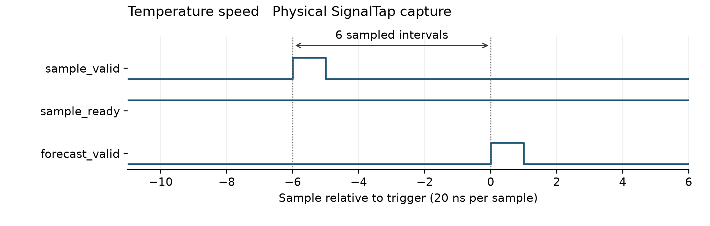
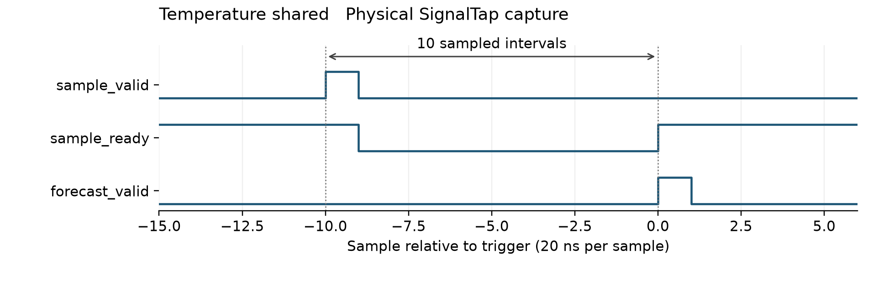
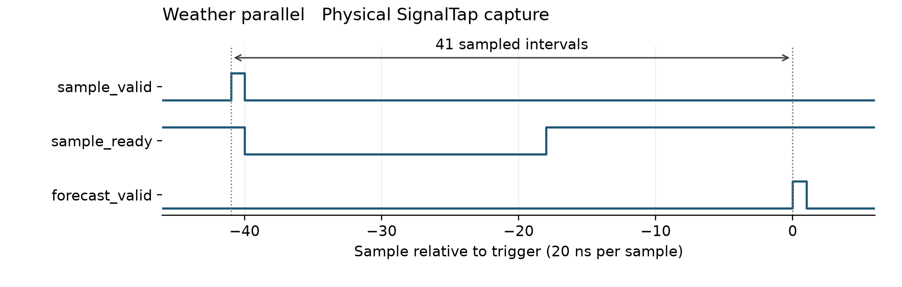
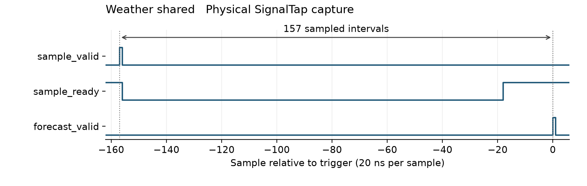

# Understanding our FPGA forecasting project from the beginning

CE436 Discrete Time Signal Processing and Applications  
Team learning report and defense guide  
Prepared on 2 November 2026

## How to read this report

Our project uses recorded hourly weather observations to predict conditions three hours into the future. A computer learns the numerical coefficients from historical data. The FPGA then uses those fixed coefficients to calculate predictions. Four implementations were tested on the DE2 board: two for the original temperature model and two for the extended weather model.

Part A explains the project with the mathematics needed along the way. It assumes that the reader knows basic arithmetic, coordinates, and the idea of a graph. Each new hardware or statistics term is explained before it is used. Numerical examples labelled as teaching examples are made to explain a calculation; they are not extra experimental results. Part B preserves the measured results and links to the files that support them.

Read A1 through A7 first to understand what the temperature predictor calculates. Read A8 through A13 to understand the circuits and verification. A14 through A17 explain the weather extension and hardware evidence. A18 through A21 support repository review and defense preparation. The technical tables in Part B become easier to explain after that reading.

The short report and this teaching report describe the same implemented project. This document adds explanations; it does not introduce a new design or claim that the board collected live sensor measurements.

## Part A Project explanation

## A1 What problem are we solving

Suppose the latest recorded temperature is at noon. We want an estimate of the temperature at 15:00. We already know temperatures from earlier hours, but we do not know the 15:00 measurement yet. Our model combines selected past values to calculate that estimate.

A forecast is an estimate, so its value can differ from the future observation. A circuit can calculate its forecasting equation perfectly and still make an inaccurate weather prediction. Learning a useful equation and implementing that equation correctly are separate jobs.

The original version predicts temperature. The extended version predicts temperature, surface pressure, relative humidity, wind speed, and wind direction. We implemented two hardware architectures for each version to investigate the tradeoff between processing speed and dedicated multiplier usage.

The input samples in the physical demonstration come from files on the computer. USB-Blaster carries requests through JTAG into the FPGA, and the computer reads the returned results. We did not attach weather sensors or add a display to the board.

### Three different meanings of time

An hourly sampling interval means consecutive observations represent conditions one hour apart. A three-hour forecast horizon means the desired target belongs three hours after the latest observation. A 50 MHz hardware clock means the circuit receives 50 million clock ticks each second.

These times belong to different parts of the system. The FPGA does not wait three hours before returning a prediction. After enough history has been loaded, the temperature speed core calculates a result in 100 ns under the documented RTL latency convention.

Recorded observations can be replayed quickly because the timestamps belong to the data. If 25 hourly samples are sent in a short burst, the FPGA still treats them as a sequence of 25 hourly observations. The host must preserve their order and meaning. The arithmetic core has no calendar that can detect an accidentally reversed input file.

## A2 Signals samples and the history window

A signal is a quantity that changes. Outdoor temperature over time is a signal. A sample is one observation of that quantity. Our recorded sequence contains one sample per hour, so it is a discrete-time sequence.

Use T(t) for the latest hourly temperature. Then T(t − 3) is the temperature three sample positions earlier, and T(t − 24) is the temperature 24 sample positions earlier. This notation describes positions in the hourly sequence. It does not mean three or 24 FPGA clock cycles earlier.

For a noon forecast, the important temperatures are:

| Symbol | Time relative to noon today | Role |
| --- | --- | --- |
| T(t) | Noon today | Current observation |
| T(t − 3) | 09:00 today | Recent trend reference |
| T(t − 21) | 15:00 yesterday | Previous day at the target hour |
| T(t − 24) | Noon yesterday | Previous day at the current hour |
| T(t + 3) | 15:00 today | Future observation used to evaluate the forecast |

The target is 15:00 today. Its matching hour yesterday is 21 hours before noon today, which explains the lag 21. The matching hour yesterday for the current observation is lag 24.

The history window holds the current value and the preceding 24 values, giving 25 samples. Only four values enter one original-temperature calculation, but the intervening samples must move through history so those lag positions remain correct when the next hourly value arrives. A host that separately supplied all four taps could use a different interface. Our implementation accepts one new temperature at a time and maintains its own history.

After reset, samples 1 through 24 fill history. Sample 25 is the first sample with all required past values available. Each later accepted sample can produce another forecast. For an uninterrupted replay of 128 inputs, the number of forecasts is 128 − 24 = 104. A reset starts the history requirement again.

## A3 The temperature equation in ordinary language

The deployed model is:

`forecast = yesterday_at_target_hour + a × daily_change + b × recent_change + c`

The quantities are:

`daily_change = T(t) − T(t − 24)`

`recent_change = T(t) − T(t − 3)`

Therefore:

`T_hat(t + 3) = T(t − 21) + a[T(t) − T(t − 24)] + b[T(t) − T(t − 3)] + c`

The hat in T_hat means an estimate. The equation starts from yesterday's temperature at the desired future hour. It then adjusts that starting point using today's difference from yesterday and the recent three-hour change. The constant c is called the bias or intercept. It permits a fixed correction even when both differences are zero.

The coefficients a and b are multipliers learned from the training data. They are not percentages that must add to one. The daily term and recent term can overlap in the information they carry. A small b does not prove that recent changes never matter; it describes the fitted contribution of that term when the other terms are also present.

Our saved floating-point coefficients are a = 0.7454870438526146, b = 0.009149444986888534, and c = 0.0011295816555433053 °C. The first two are dimensionless because they multiply temperature differences. The bias has temperature units.

The model is linear in the learned parameters. Once its inputs are known, the unknowns a, b, and c appear only multiplied by known quantities and added together. A linear model can use delayed values and differences. It does not require the forecast to be a straight line against clock time.

## A4 How ordinary least squares learns the coefficients

Training means choosing coefficients using examples with known answers. For a past noon in the training period, we already know the temperature measured at 15:00 that day. That future measurement becomes the answer for this historical example.

For each eligible time, define x1 as the daily change, x2 as the recent change, and y as the future observation minus yesterday's target-hour observation. The equation used for fitting becomes:

`predicted_y = a × x1 + b × x2 + c`

For one row, the residual is predicted_y minus observed_y. Ordinary least squares, abbreviated OLS, chooses a, b, and c to minimize the sum of squared residuals over all training rows. Squaring removes the sign and gives larger mistakes more influence.

If three residuals are 1, −2, and 0.5 °C, their squared-error sum is 1 + 4 + 0.25 = 5.25 °C². OLS searches for coefficients that make the training sum small. It does not minimize the later test MAE directly.

### A small teaching example

The following invented rows have an exact linear relationship. They illustrate fitting without requiring a large weather file.

| Row | x1 | x2 | Observed y |
| --- | --- | --- | --- |
| 1 | 0 | 0 | 1 |
| 2 | 2 | 0 | 2 |
| 3 | 0 | 4 | 2 |
| 4 | 2 | 4 | 3 |

Row 1 gives c = 1. Row 2 then gives 2a + 1 = 2, so a = 0.5. Row 3 gives 4b + 1 = 2, so b = 0.25. Row 4 confirms the result: 0.5 × 2 + 0.25 × 4 + 1 = 3. These teaching coefficients are unrelated to our deployed coefficients.

Real weather rows do not usually agree on one perfect solution. Thousands of equations constrain only three unknown coefficients. Least squares finds a compromise. In matrix notation, stack each row [x1, x2, 1] into a matrix X, and stack the observed y values into a vector y. The parameter vector contains [a, b, c]. The fitting problem is to minimize the squared length of X times the parameter vector minus y.

A matrix is a rectangular table of numbers. Matrix multiplication here is repeated multiply-and-add calculation across rows. A numerical least-squares solver handles the fit. The normal-equation expression involving the inverse of X transpose times X applies when the required inverse exists, but a numerical least-squares solver also handles cases where that expression is unreliable or undefined. We do not implement a matrix inverse on the FPGA.

### Where training happens

Training runs on the computer. Its result is a small set of coefficients saved to model files. The FPGA uses those coefficients for inference, which means applying the equation to new input samples. The deployed hardware does not update the coefficients after each forecast. Retraining and changing the static coefficient files or generated RTL require a rebuild of the corresponding FPGA design.

## A5 How we check forecast quality fairly

A model can fit its old examples well and predict new examples badly. We therefore use separate time periods. The weather training targets end before 2024. Validation uses 2024 inputs whose targets remain before 2025. Test inputs belong to 2025, with unavailable future targets excluded.

Training estimates coefficients. Validation compares candidate model choices. Test evaluation measures the selected, frozen model on a later period. If test answers influence coefficient selection, the test loses its role as an independent later-period evaluation.

The weather preparation requires 25 consecutive valid hourly observations and a valid future target. It excludes unusable rows. The recorded example counts are 26,253 for training, 8,781 for validation, and 8,757 for test. These are usable examples after the timing and validity rules, not simply the number of calendar hours in those years.

A baseline is a simple predictor used for comparison. Persistence predicts T(t + 3) = T(t), which assumes the temperature will stay at its current value. The diurnal baseline predicts T(t + 3) = T(t − 21), which assumes the previous day's value at the target hour will repeat. Our temperature model adds learned corrections to that second idea.

Mean absolute error, or MAE, averages the sizes of the prediction errors. For errors 1, −2, and 0 °C, MAE is (1 + 2 + 0) / 3 = 1 °C. An MAE of 0.538017 °C means the average absolute difference on the evaluated test set has that value. It does not mean every forecast lies within 0.538017 °C.

Root mean square error, or RMSE, squares the errors, averages the squares, and takes the square root. For the same example, RMSE is square root of 5/3, approximately 1.291 °C. RMSE gives relatively more influence to larger errors. Both metrics have the same unit as the target.

Our original fixed-point temperature model has test MAE 0.538017 °C and RMSE 0.785955 °C. Persistence has MAE 2.080369 °C, and the previous-day baseline has MAE 0.832280 °C. These comparisons support improvement on this particular test set. They do not establish performance for all locations or future years.

Do not convert MAE into an accuracy percentage by dividing by an arbitrary Celsius temperature. Celsius has an arbitrary zero, and such a percentage would change under conversion to another temperature scale.

## A6 Why the FPGA stores integers

An FPGA is a chip whose configurable logic implements digital circuits. Verilog describes the circuit structure and behavior. Quartus translates that description into hardware resources and connections. A register stores bits between clock edges; combinational logic calculates from its current inputs.

Floating-point numbers encode a value using a sign, an exponent, and a significant part. They offer a wide range, but our design uses fixed-point integers so that widths and scaling are explicit. Fixed point places the binary point at an agreed location without storing an actual point bit.

A temperature raw integer q represents q / 256 °C because eight binary fractional bits give a scale factor of 2 to the power 8, or 256. Thus 25 °C becomes raw 6400, hexadecimal 1900. A raw value of 1 represents 0.00390625 °C, one quantization step.

The original temperature format uses a total of 16 signed bits and eight fractional bits. Its raw integer range is −32768 through 32767. Its represented range is −128 through 127.99609375 °C. Our documentation calls this signed Q8.8. Because Q notation has varying sign-bit conventions, always state the total width and fractional-bit count when explaining it.

Two's complement represents signed integers in the circuit. All ones in a signed 16-bit word means −1, so raw FFFF represents −1/256 °C. Treating that same word as unsigned would produce a completely different value. Signed declarations and sign extension matter throughout the arithmetic.

A and B represent a and b multiplied by 16384, because their coefficient format has 14 fractional bits. The saved hardware values are A = 12214 and B = 150. C uses the temperature scale of 256 and becomes zero. The floating bias is approximately 0.00113 °C, smaller than half a temperature quantization step, so nearest quantization maps it to zero.

Zero deployed bias does not mean that we fitted a two-parameter model. OLS fitted three parameters. The fixed-point representation rounded one fitted value to zero. The implementation still contains the bias term and supports testing other bias values.

## A7 A complete forecast calculation

The following teaching input uses the actual deployed coefficient integers. Let the current temperature be 30 °C, the temperature three hours ago 28 °C, yesterday at the target hour 31 °C, and yesterday at the current hour 29 °C.

The floating-point calculation is:

`forecast = 31 + a × (30 − 29) + b × (30 − 28) + c`

Substitution gives approximately 31.7649155 °C. The FPGA performs the equivalent scaled-integer calculation below.

| Quantity | Physical interpretation | Raw integer |
| --- | --- | --- |
| q0 | 30 °C | 7680 |
| q3 | 28 °C | 7168 |
| q21 | 31 °C | 7936 |
| q24 | 29 °C | 7424 |
| D1 = q0 − q24 | 1 °C difference | 256 |
| D2 = q0 − q3 | 2 °C difference | 512 |
| A × D1 | Daily correction at product scale | 3126784 |
| B × D2 | Recent correction at product scale | 76800 |
| (q21 + C) × 16384 | Aligned starting value and bias | 130023424 |
| S | Sum before scale reduction | 133227008 |

Multiplying a Q14 coefficient integer by a Q8 temperature integer produces a value with 22 fractional bits. The anchor has only eight fractional bits, so multiplying it by 16384 aligns it to the same scale before addition. Adding unaligned terms would be like adding centimeters to a number still expressed in meters.

After summing, the output raw integer is floor(S / 16384) = floor(8131.53125) = 8131. It is within the signed 16-bit range, so saturation does not change it. Dividing by 256 gives the FPGA prediction, 31.76171875 °C.

The difference from the floating-point answer is approximately 0.00320 °C. This is an arithmetic approximation difference. To calculate forecast error for this example, we would also need the actual temperature measured three hours later. No such future observation is part of this teaching example.

### Negative scaling and saturation

Arithmetic right shift by 14 implements floor division by 16384 for the signed values in our contract. If the accumulator is −1, the scaled integer must be −1, not zero. C++ signed integer division truncates toward zero, so the C++ reference includes an explicit correction for a negative remainder. This avoids a one-count disagreement with RTL.

Saturation limits a result to the representable endpoints. A scaled raw result of 40000 becomes 32767; a result of −40000 becomes −32768. Simply keeping the lowest 16 bits would wrap the number, potentially reversing its sign. The recorded temperature SignalTap transaction intentionally reaches positive saturation. Raw 7FFF means 127.99609375 °C in this format and is an arithmetic corner case, not a realistic ambient forecast.

### Why intermediate words are wider

Subtracting the most negative signed 16-bit value from the most positive gives 65535, which needs 17 signed bits. A 17-bit difference multiplied by a 16-bit coefficient needs a full 33-bit product. Adding the products and aligned anchor and bias requires further room; the implementation uses a 35-bit accumulator. Narrowing before the sum could lose information even when the final answer would fit.

## A8 How the speed circuit works

The speed temperature design divides the calculation into stages separated by registers. This is a pipeline. Several different forecasts can occupy different stages at once, just as several workpieces can occupy different stations on an assembly line.

Let edge N be the rising clock edge that accepts an eligible input. An eligible input has enough history to generate a forecast. The actual pipeline performs:

| Edge | Operation for this input |
| --- | --- |
| N | Capture current temperature and delayed taps |
| N + 1 | Calculate the two 17-bit differences |
| N + 2 | Calculate both products in parallel and align anchor plus bias |
| N + 3 | Add the products |
| N + 4 | Add the aligned base to form the full accumulator |
| N + 5 | Scale, saturate, and assert forecast_valid |

There are six capture stages listed, but five edge intervals between N and N + 5. The project's latency convention measures those intervals, giving latency five cycles. At 50 MHz, one period is 20 ns, so five periods equal 100 ns.

After warm-up, this core can accept a new sample every cycle while previous predictions move through the pipeline. That gives initiation interval one. It does not make every prediction arrive in one cycle; each still travels through the same stages.

The RTL moves a valid bit alongside the data through each stage. A value in a data register is meaningful as an output prediction only when its matching valid bit is asserted. Data registers can change on cycles that do not represent accepted requests.

### Understanding the delayed tap indices

In the speed RTL, the accepting edge both shifts the history and captures the taps using nonblocking assignments. Right-hand sides use the old register values. The current input is T(t), old hist[2] supplies T(t − 3), old hist[20] supplies T(t − 21), and old hist[23] supplies T(t − 24).

After that edge, the newly shifted hist[0] contains T(t), so the same logical lags occupy indices 3, 21, and 24. Reading the speed capture's old indices as if they were post-shift indices would create an off-by-one interpretation. The C++ reference shifts its software history first and then reads indices 0, 3, 21, and 24, producing the same mathematical taps.

## A9 How the shared temperature circuit works

The shared design uses one multiplier for both products. A finite-state machine, or FSM, stores which operation should happen next and enables the corresponding datapath register. A multiplexer selects which operand or coefficient feeds the shared arithmetic unit.

| Edge | Work for an accepted forecast input |
| --- | --- |
| N | Accept input, update history, and save current temperature |
| N + 1 | Save the daily difference |
| N + 2 | Save product A |
| N + 3 | Save the recent difference |
| N + 4 | Save product B |
| N + 5 | Load product A into the accumulator |
| N + 6 | Add product B |
| N + 7 | Add the aligned previous-day target value |
| N + 8 | Add the aligned bias |
| N + 9 | Scale, saturate, and publish the output |

The next eligible input can be accepted at edge N + 10. The resulting latency is nine cycles and the sustained initiation interval is ten cycles. Warm-up transfers can proceed differently because they only fill history and do not start the full calculation.

Sharing reduces the number of dedicated multipliers, but selection logic, state registers, and history implementation consume other resources. The measured temperature JTAG design with sharing uses more logic elements and registers than the speed version. Calling it resource optimized means that it targets arithmetic reuse; the results must identify which resource actually decreased.

Both architectures compute the same fixed-point equation. Their predictions should match for the same accepted input sequence. Their output clock numbers differ because their schedules differ.

## A10 Handshaking reset and sample order

A handshake specifies when the sender and receiver agree that data has transferred. Our input transfer occurs at a rising edge when sample_valid and sample_ready are both high, while reset is inactive. Valid means the sender is presenting a sample. Ready means the core can accept it.

If valid is high while ready is low, the sender must hold that pending value and valid assertion until acceptance. If valid is low, changes on the input bus are ignored. History advances only for accepted samples. Counting every clock as another hour would corrupt all delayed taps.

A simple teaching sequence is:

| Clock edge | valid | ready | Input action |
| --- | --- | --- | --- |
| 10 | 1 | 1 | Accept sample A |
| 11 | 1 | 0 | Hold sample B pending |
| 12 | 1 | 0 | Continue holding the same B |
| 13 | 1 | 1 | Accept B once |
| 14 | 0 | 1 | Accept nothing |

The core has no output ready signal. A consumer must capture every result when forecast_valid is high. It cannot ask the core to repeat a result later. The JTAG mailbox provides persistent storage so that a slow computer can still read the last completed result.

Reset is synchronous and active low. The RTL performs its reset behavior at a rising edge when rst_n is zero. Reset clears validity and history eligibility and cancels pending predictions. Not every physical history bit needs clearing because no prediction is allowed until enough new samples overwrite the required window. The board wrapper handles the external reset path before it reaches the synchronous core.

Reset priority matters. Input values presented during reset must not count as new valid history. Tests deliberately exercise this case and reset while a forecast is in flight.

## A11 What the SystemVerilog driver does

The driver is the simulation code that behaves like an input sender and a result checker. It creates the clock, controls reset, presents samples, observes the handshake, and checks the returned predictions. The DUT, or device under test, is the real forecasting RTL.

The shared file ols_tb_driver.sv does not read internal DUT registers to decide the correct result. It checks the public interface. This black-box approach permits different internal implementations as long as they satisfy the same arithmetic and timing contract.

Stimulus changes on falling edges. Acceptance is observed at the rising edge using the ready value before the DUT updates its registers. Output checks run 1 ns later in simulation, allowing nonblocking assignments to finish. That 1 ns is a testbench observation delay; it is not an extra FPGA pipeline stage.

Whenever an input is accepted, the driver calls the C++ model. During the first 24 accepted samples, the model reports no prediction. Later it returns the expected raw result. The driver stores that result in a queue with its accepted-sample number and the expected output cycle, acceptance cycle plus configured latency.

A scoreboard is this record of expected transactions and the logic that compares actual outputs against it. If a valid output arrives, the scoreboard checks the oldest pending prediction, its value, and its due cycle. It fails on a wrong value, early or late result, missing result, extra result, or invalid ordering. The test also checks ready behavior and the initiation interval.

On reset, the driver clears the C++ history and pending expected queue. Predictions canceled by reset are counted separately. Its accounting checks that eligible predictions equal checked predictions plus canceled predictions. Otherwise, a lost output could hide behind reset handling.

### Why random traffic is useful

A constant 25 °C sequence gives an easy sanity check, but it does not exercise negative arithmetic, saturation, changing taps, or stalls. Directed tests target known corner cases. Deterministic pseudorandom traffic explores many other combinations and permits a failing sequence to be reproduced.

The tests include invalid input gaps, continuous requests, signed extremes, positive and negative saturation, negative fractional accumulators, and reset interruptions. A finite simulation samples behavior; it cannot prove every possible input sequence.

The checker itself also needs testing. Deliberately faulty behavioral models can return a corrupt value, return early, omit a result, retain stale valid on reset, or violate ready behavior. The self-test is successful only when the checker rejects the intended faults. Passing those checker tests does not verify the production RTL; production runs instantiate the real cores separately.

## A12 What DPI C and the C plus plus reference contribute

DPI-C is the SystemVerilog Direct Programming Interface for calling C-compatible functions. Our C++ arithmetic model exposes a C-compatible bridge so the SystemVerilog simulation can call it directly. No C++ program is synthesized into the FPGA by this verification flow.

The bridge creates a model context, resets it, pushes an accepted sample, and destroys it at the end. A context owns its history and coefficients. Separate contexts keep tests from accidentally sharing state.

The C++ model uses 64-bit integers for the original temperature calculation, explicit floor scaling, and saturation. It expresses the arithmetic in a different form from the staged RTL, which helps reveal width or scheduling mistakes. It still implements the same specification, so it is not an independent proof that the forecasting model is scientifically useful.

The reference includes hand-calculated checks for warm-up, reset, negative floor division, saturation, and a small numerical example. These provide anchors that can catch a mistake shared by more elaborate simulation paths.

Offline vectors generated with this same C++ model are useful for replay and file-format checking. Agreement between those vectors and a live call to the same model is a consistency check, not two independent mathematical oracles. Comparing either one with real RTL checks the hardware implementation.

Temperature production verification uses the trained model and a coefficient matrix, meaning several separate coefficient configurations. Test defaults such as a = 0.5 are test stimulus, not the deployed trained coefficients. The resource testbench's historical latency default also differs from the final RTL latency. The documented production command explicitly selects five and nine cycles.

Verilator's usual two-state simulation cannot establish detection of every X or Z condition. Four-state checks retained in SystemVerilog need a simulator mode that represents those states to exercise that behavior.

## A13 How to read the verification evidence

There are three different comparisons in this project. Forecast evaluation compares a prediction with the future recorded observation. Numerical evaluation compares fixed-point output with floating-point output. Implementation verification compares RTL or physical output with the fixed-point reference for identical inputs.

The original temperature model's fixed-versus-floating mean absolute difference is approximately 0.003161 °C. Its test forecast MAE is approximately 0.538017 °C. The much smaller first number says the chosen numerical representation changes the model only slightly on those inputs. It does not replace the second number.

An implementation PASS means all checks in that particular test completed without a detected mismatch. It needs its scope and sample count. A 104-forecast board replay is physical evidence for those transactions; it is not evidence of a year-long live deployment.

| Verification step | What it checks | Important boundary |
| --- | --- | --- |
| Software forecast evaluation | Predictions against later observations | Dataset and chosen time split |
| RTL with DPI-C | Arithmetic, protocol, reset, order, and cycle timing | Simulated production RTL |
| Functional netlist replay | Logic after synthesis or mapping | Simulator and vendor atoms |
| Static timing analysis | Estimated setup and hold constraints | Declared clocks and constraints |
| SDF timing simulation | Netlist operation with annotated path delays | Predictor core timing netlist |
| Physical JTAG replay | Actual programmed FPGA responses | Recorded replay at 50 MHz |
| SignalTap capture | Selected internal signals on the FPGA | Saved acquisition window |

Synthesis converts RTL into a netlist, a description of components and connections. Fitting places those components in the chosen device and routes the wires. A design can simulate correctly in RTL and still fail a timing constraint after routing.

SDF stands for Standard Delay Format. It supplies delay values to a timing simulation of the fitted netlist. The accepted core timing runs use maximum SDF delays and a 20 ns clock. A run with missing annotation would not provide the same evidence even if it printed PASS elsewhere, so the stored timing manifests record the relevant files and statuses.

Static timing analysis checks paths without enumerating input vectors. Setup slack measures the margin for data arriving early enough before capture. Hold slack measures the margin for data remaining stable long enough after capture. Positive reported slack means the analyzed check has margin under the declared model. Constraint coverage still matters; a positive number is meaningful within its stated timing assumptions.

## A14 What changes in the weather extension

The weather dataset is NASA POWER hourly environmental data for Ho Chi Minh City at latitude 10.8231° N and longitude 106.6297° E, covering 2021 through 2025 in UTC. It provides gridded values. It is not a measurement stream collected by our DE2 board.

The fields are T2M for temperature, PS for surface pressure, RH2M for relative humidity, WS10M for wind speed, and WD10M for wind direction. Their units in this project are °C, kPa, percent, m/s, and degrees. Mixing a pressure unit or time-zone convention would invalidate an otherwise correct calculation.

The extended system considers several candidate models using validation data. The selected scalar models use seven delayed values of the same variable. This is univariate autoregression: auto refers to predicting a variable using its own past values, and regression refers to fitting numerical relationships.

For a scalar variable x, the selected equation has the form:

`x_hat(t + 3) = bias + w0×x(t) + w1×x(t−1) + w2×x(t−3) + w3×x(t−6) + w4×x(t−12) + w5×x(t−21) + w6×x(t−24)`

A lag is a delay measured in input sample positions. The lag set is 0, 1, 3, 6, 12, 21, and 24. Each channel has its own coefficients and bias. The saved model uses a larger feature representation for candidate comparisons, but the selected models have nonzero weights only for the same variable's seven lags.

Ridge regression adds a penalty on coefficient size to the squared-error objective. This can discourage large coefficients when past inputs carry overlapping information. In the training script, the inputs are standardized for fitting, and the fitted coefficients are converted back to the original units. Standardization subtracts each training input's mean and divides by its standard deviation. The deployed hardware uses the converted coefficients, so it does not repeat that preprocessing for each sample.

Temperature and humidity select ridge penalty 1. The other selected channels use penalty 0, which removes that regularization penalty. These choices won among the candidates that were evaluated. They are not proof that no other model could perform better.

The weather temperature test MAE is 0.507906 °C, compared with 0.538017 °C for the original three-parameter model. The extension also changes the equation, widths, and circuit, so present this as a model and implementation comparison. It is not the same hardware becoming more accurate merely because it runs faster.

## A15 Why wind direction needs special treatment

Angles wrap around. Directions 359° and 1° are two degrees apart around the circle, even though ordinary subtraction gives 358°. Directly averaging or fitting raw angle values near that boundary can produce misleading results.

The host represents an angle theta by two components, cos(theta) and sin(theta). In ordinary coordinate terms, these locate a point on the unit circle. For teaching examples, 0° corresponds to (1, 0), 90° to (0, 1), and 180° to (−1, 0). This is a numerical angle encoding; a wind direction value retains the dataset's meteorological meaning.

The system predicts the cosine and sine channels separately. It then recovers an angle using atan2(sine, cosine), which identifies the correct quadrant. The predicted pair does not have to lie exactly on the unit circle for its nonzero direction to be calculated.

A zero pair has no direction. Our hardware emits angle zero and sets direction_defined to zero for that pair. A zero-degree output with direction_defined equal to one has a different meaning and must not be confused with the undefined case.

CORDIC calculates the angle in RTL using repeated shifts, additions, and a table of small rotation angles. The vectoring process reduces the vertical component toward zero while accumulating the corresponding angle. The implemented unit performs 16 iterative steps and handles quadrants and wrapping. Reading its source reveals how the numerical iterations are scheduled; there is no general floating-point atan2 unit in the FPGA.

Direction therefore needs six arithmetic channels in total: temperature, pressure, humidity, wind speed, cosine, and sine. The final human-readable outputs still describe five weather quantities because the last two channels describe one direction.

Direction forecast scoring uses circular angular distance and includes target wind speeds of at least 0.5 m/s. That threshold is an evaluation policy. It is separate from the zero-vector validity rule.

The reported 18.084598° direction test MAE uses ideal floating-point atan2 applied to quantized predicted components. CORDIC conversion is tested separately: 263,169 integer pairs were checked, with maximum circular error 0.005635°. The board angle checker permits five raw Q8 degree counts, or 0.01953125°. The conversion tolerance is not the weather prediction MAE.

## A16 The weather hardware schedule and number formats

Weather input and scalar output channels use 18 signed bits with eight fractional bits. The represented range is −512 through 511.99609375 in the channel's unit. The wider range accommodates values such as pressure while retaining the same step of 1/256.

Weights use 18 signed bits with 14 fractional bits. Biases use signed 32-bit integers at Q8 scale. A full product has 36 bits, and the accumulator has 48 bits. The arithmetic aligns bias and products, floors during scale reduction, and applies the specified output limits.

Humidity is limited to 0 through 100 percent. Wind speed is limited to nonnegative values. Direction components are limited to −1 through 1. Such limits keep outputs within their declared ranges; they do not guarantee that the underlying prediction is accurate.

The parallel weather design has one arithmetic lane per channel. Each lane reuses its multiplier across that channel's seven terms. Parallel therefore means the channels calculate together, not that all 42 products are calculated in one cycle. The shared weather design uses one multiplier across all channels and terms.

The full-system results include direction reconstruction. Their documented latencies are 40 cycles for parallel and 156 for shared, equivalent to 0.80 µs and 3.12 µs at 50 MHz. Their sustained acceptance intervals are 23 and 139 cycles after warm-up.

An initiation interval shorter than full-system latency is possible because one part of a prediction can be completed while another part, such as angle conversion, is still running. The system aligns scalar data with the completed direction result. Software must treat forecast_valid as the complete-output indicator.

Both systems are fast relative to hourly sampling. The architectural comparison is still useful for understanding reuse, timing, control overhead, and how such arithmetic would scale to more demanding workloads. Our evidence does not measure a practical need for millions of weather forecasts per second.

## A17 How the computer communicates with the board

USB-Blaster provides access to the FPGA's JTAG infrastructure. It is not a normal USB serial adapter. We use a Quartus In-System Sources and Probes IP block, abbreviated ISSP, to expose a source word that the computer writes and a probe word that it reads.

The source word has 128 bits. It carries payload data, a request toggle, and a reset bit. The probe word has 256 bits. It carries the last result, counters, status flags, an acknowledgement toggle, and a signature identifying the design.

A mailbox is the control circuit between that debug transport and the forecasting core. The computer first stages the payload while keeping the old request bit, then changes the request bit to commit the transaction. A toggle means the bit changes from its previous value; successive requests can alternate 0 to 1 and 1 to 0.

The mailbox waits for synchronized source values and additional settling cycles before capturing the payload. It holds the core input until the core accepts it. During warm-up, it can acknowledge without a forecast. After warm-up, it captures the completed prediction before acknowledging completion.

The computer holds payload and request unchanged until acknowledgement. It then reads a stable completed probe word. Only one transaction may be outstanding. This protocol prevents a slow computer from overwriting a pending request or missing a one-clock forecast_valid pulse.

The last-result-valid bit stays set until reset. It means the mailbox contains a result. Core forecast_valid is a transient event. These flags have different jobs, so a screenshot of a persistent result flag is not a direct waveform measurement of the core pulse.

The counters make a replay easier to audit. After 128 accepted inputs without reset, a forecast count of 104 matches the 24-input warm-up rule. Counters are 16 bits and wrap modulo 65536; their finite width should be considered in longer sessions.

In the deployed design, the result appears in the host replay output, saved CSV, or Quartus In-System Sources and Probes Editor. There is no result display on LEDs, seven-segment displays, or LCD. UART wrappers exist, but physical UART operation has not been verified.

## A18 What Quartus results and SignalTap prove

A logic element, or LE, is a basic configurable logic resource in Cyclone II. Registers store state. Memory bits report mapped storage. Dedicated multiplier elements perform multiplication using device arithmetic resources. These categories can change independently.

The uninstrumented temperature speed JTAG build uses 1,130 LEs, 1,016 registers, 336 memory bits, and four 9-bit multiplier elements. The shared build uses 1,541 LEs, 1,352 registers, zero mapped memory bits, and two multiplier elements. Zero mapped memory bits does not mean the design stores no history; history may be implemented in registers or logic resources.

The weather parallel JTAG build uses 6,253 LEs and 12 multiplier elements. The shared build uses 5,598 LEs and two multiplier elements. Two 9-bit elements correspond to one full 18 by 18 multiplier resource on this target. These reported units must be stated when comparing designs.

Fmax is the timing tool's estimate of maximum clock frequency under its analyzed constraints. The temperature estimates are 190.48 MHz for speed and 139.37 MHz for shared. The weather estimates are 79.74 and 79.23 MHz. Physical tests used 50 MHz. We did not experimentally sweep the board clock to establish these estimates as measured hardware limits.

Core-only, JTAG-wrapped, and SignalTap-instrumented designs have different contents. A core count should not be compared with another design's whole-board count without explaining the boundary. SignalTap adds capture logic and memory, so the architecture comparison uses the uninstrumented JTAG builds.

### Reading a saved waveform

SignalTap is an embedded logic analyzer. Quartus adds circuitry that samples selected FPGA signals into on-chip acquisition memory. A trigger selects an event of interest. The host retrieves the recorded samples through JTAG.

Our captures have 512 samples at 50 MHz, so neighboring samples are 20 ns apart. The forecast-valid trigger is at capture index 256. For the temperature speed capture, the accepted input is at index 250 and the visible valid sample at 256, giving raw separation six samples.

The scoreboard defines output latency by observing registers after the clock edge updates; SignalTap samples values at its acquisition edge. Under these documented conventions, raw separations are one greater than the post-edge RTL latency. The four raw separations are 6, 10, 41, and 157, while RTL latencies are 5, 9, 40, and 156. Keep the raw indices when presenting a captured waveform and state the observation convention.

First identify the accepting input, using valid and ready together. Then identify forecast_valid and decode the output at that valid event. Ignore other bus changes as predictions when valid is low. Finally compare the decoded valid result with the corresponding reference transaction.

The four waveform plots in Part B are drawn from the saved physical CSV data. The native Quartus screenshots and STP capture files remain linked as original evidence. A plot drawn from a physical capture is useful for readability; its provenance should remain clear.

## A19 Where to look in the repository

Paths below are relative to the fpga-temp-predictor repository root. Open these alongside the explanation. Reading the files in this order follows one sample from the mathematical model to the saved physical result.

1. software/models_cpp/model.json contains the learned original coefficients. Check that its a, b, and c agree with the report.
2. hardware/tb/dpi/ols_reference.hpp contains the original fixed-point reference. Trace push, history, floor_scale, and saturate with the A7 teaching example.
3. hardware/speed_optimized/temp_predictor_speed.v contains the pipeline. Follow one input and its valid bit from stage 0 to stage 5.
4. hardware/resource_optimized/temp_predictor_resource.v contains the shared controller. ols_shared_datapath.v in the same directory contains the reused arithmetic, and temp_history_buffer.v contains history.
5. hardware/tb/ols_tb_driver.sv contains stimulus and the scoreboard. Find the handshake, ols_ref_push call, expected queue, due cycle, and reset cancellation.
6. versions/weather_v2/software/train_models.py constructs lagged examples, splits time periods, fits candidates, and chooses the weather models. models/model.json in the weather version records the selected coefficients.
7. versions/weather_v2/rtl/weather_ar_channel.v implements one weather channel. weather_predictor_resource.v implements sharing across channels. weather_system_speed.v and weather_system_resource.v include the direction path; wind_direction_cordic.v implements angle conversion.
8. hardware/jtag contains the board transport wrappers and protocol description. scripts/replay_jtag.tcl drives the physical replay through Quartus.
9. docs/reports contains metrics, implementation reports, physical CSVs, timing manifests, and defense_session evidence. Part B links the exact evidence used here.

Some older README paragraphs describe earlier integration assumptions or stages before physical access worked. The final RTL, explicit production commands, saved physical results, and manifests support the final results in this report. For example, the production shared temperature latency is nine cycles, even if an older generic testbench default lists eight.

### A safe way to reproduce the checks

Start with offline review of the model, test results, and saved captures. These do not require the board. RTL verification and Quartus compilation also run without a physical DE2, provided the necessary tools and libraries are installed.

For temperature production verification, use the file-coefficient flow, the trained model, all production RTL dependencies, and explicit speed latency 5 and resource latency 9. The exact maintained command is in the real-RTL integration section of hardware/tb/README.md. Do not use the behavioral self-test command as proof that the production circuit passed.

To view or rebuild a physical design, open the matching JTAG project listed in Part B. Core-only projects are measurement builds and should not be assumed to have the DE2 board pin map. The board projects use CLOCK_50 at pin N2 and KEY0_N at pin G26; JTAG uses dedicated device infrastructure.

A live demonstration requires the powered board and USB-Blaster. Select the correct project's SOF, program it, and run the matching replay variant. The script verifies the variant identity before sending samples. Temperature's legacy replay name temperature refers to the speed variant; temperature_resource selects the shared variant. Weather uses weather_speed or weather_resource.

A power cycle clears the FPGA's SRAM configuration, so reload the SOF for a later live demonstration. Saved reports, captures, screenshots, and CSV evidence remain available without the board. Do not promise a live demonstration solely because an offline capture can still be opened.

## A20 Questions your team should be able to answer

### What did we build

We built fixed-point forecasting circuits on the DE2 Cyclone II FPGA. The original model predicts temperature three hours ahead using a seasonal three-parameter OLS equation. The weather extension predicts additional environmental quantities using selected seven-lag models. Each version has a parallel or pipelined architecture and a multiplier-sharing architecture.

### What makes this a DSP project

It processes sampled time sequences using delayed observations, linear weighted combinations, finite history, and quantized arithmetic. The original equation can be expanded into weighted taps at lags 0, 3, 21, and 24 plus a bias. It therefore has a finite-memory linear signal-processing structure, with an affine offset when the bias is nonzero. The coefficients are fixed during operation.

### Why use 25 samples when there are only three parameters

Parameters are learned constants. Samples are observations. The three constants a, b, and c do not replace the input history. The largest delay is 24, so the current sample plus 24 older positions require a 25-sample window.

### Does the FPGA perform OLS training

No. The computer fits coefficients offline. The FPGA performs the trained model's inference. We should say FPGA implementation of an OLS-trained predictor and explain this training boundary explicitly.

### Why did we build two architectures

They calculate the same fixed-point result using different schedules and arithmetic reuse. The speed temperature circuit accepts an input every cycle after warm-up. The shared circuit uses one multiplier and accepts eligible inputs less often. The measured tables show the actual cost in each resource category.

### Is the shared circuit always smaller

No. The temperature shared JTAG build reduces dedicated multiplier usage but increases LEs and registers. The weather shared JTAG build reduces both multiplier usage and the reported logic totals. A resource claim must name the resource and implementation boundary.

### Why is the bias zero in hardware

The fitted floating bias is smaller than half a Q8 step and quantizes to zero. The fit still has three parameters, and the numerical contract still includes the bias term.

### How do we know the arithmetic is correct

The production RTL is checked against a fixed-point C++ model through DPI-C, with exact schedule and protocol checks. Netlist and SDF runs check later implementation stages. Physical JTAG replay checks the programmed board against reference vectors. Saved SignalTap data records selected physical transactions.

### Is a physical PASS the same as accurate forecasting

No. Physical replay checks implementation agreement. Forecast accuracy comes from comparing model predictions with later observations in the chronological test set. Both kinds of result are needed for their respective claims.

### What does the 7FFF waveform value mean

It is the signed 16-bit positive saturation endpoint. The captured directed transaction tests an arithmetic corner case. It should be decoded as a numerical limit, not presented as a realistic outside temperature.

### Why does SignalTap show six samples for a five-cycle core

The capture records values at its acquisition edge, while the RTL latency definition observes updated registered outputs after the edge. The saved raw indices differ by six for temperature speed. The documented post-edge RTL latency is five. Explain both observation conventions and preserve the capture as recorded.

### Can this system predict rain

Precipitation probability is not an implemented output. Adding it would require defining a target, obtaining appropriate labels, selecting a model, and evaluating that model separately. The current weather outputs do not establish a validated rain predictor.

### Does AI assistance replace our understanding

The defense still requires the team to explain the equation, interface, numerical rules, architecture tradeoffs, and evidence. A tool can generate code that passes the existing checks while leaving errors outside their scope. Team review should therefore reproduce representative calculations and trace the checks that support each claim.

## A21 Worked exercises for the team

These exercises check understanding. Their numbers are teaching examples, not additional project measurements. Each team member should attempt them before reading the answers.

### Exercise one Decode the output

A signed temperature result is raw 6400. What does it mean? A second result is hexadecimal FFFF. What does that mean?

Answer: 6400 / 256 = 25 °C. FFFF is signed −1, so it represents −0.00390625 °C. The hexadecimal word must be interpreted with its signed width before scaling.

### Exercise two Count the forecasts

An uninterrupted run after reset accepts 50 hourly samples. How many forecasts are eligible? What happens if reset occurs after sample 30 and 20 further samples are accepted?

Answer: The uninterrupted run has 50 − 24 = 26 eligible forecasts. Before the reset, the first 30 accepted samples make six eligible forecasts, subject to any in-flight cancellation at reset. The new 20-sample history is too short to generate a post-reset forecast. The distinction between eligible, completed, and reset-canceled results matters.

### Exercise three Calculate latency and throughput

At 50 MHz, what is nine cycles? Does latency nine imply that the shared temperature circuit accepts an input every nine clocks?

Answer: A clock period is 20 ns, so nine cycles is 180 ns. The sustained initiation interval is ten clocks for eligible predictions. Latency and acceptance interval describe different events.

### Exercise four Explain the anchor

If the latest sample is 18:00 and the horizon is three hours, which observation is T(t − 21)?

Answer: It is 21:00 on the previous day, which matches the forecast target hour. The anchor is determined by target-hour alignment, not simply by taking yesterday's latest-input hour.

### Exercise five Check a constant stream

With the deployed bias integer zero, all accepted temperatures are exactly 25 °C. What should both temperature circuits predict after warm-up?

Answer: Both differences are zero, and the anchor is 25 °C, so the forecast is raw 6400, or 25 °C. This checks a simple functional property. It does not test changing history, saturation, or real forecast quality.

### Exercise six Diagnose a wrong result

The floating-point model and RTL differ by one raw output count on some negative fractional cases. Where would you look first?

Answer: Check scale reduction and signedness. In particular, ordinary C++ integer division truncates negative values toward zero, while the specified arithmetic shift floors them. Also verify sign extension before subtraction, multiplication, and addition. A one-count discrepancy has a different likely cause from a lag that is consistently one sample wrong.

### Exercise seven Read the evidence correctly

A compilation report shows 190.48 MHz Fmax. The board replay passed at 50 MHz. What can you claim?

Answer: The fitted timing analysis estimated 190.48 MHz under its constraints, and physical replay passed at 50 MHz. The evidence does not establish that the physical board was tested at 190.48 MHz.

### Exercise eight Explain circular error

The forecast is 359° and the observed direction is 1°. What angular error should the direction evaluation report?

Answer: Two degrees, because circular distance follows the shortest path around the circle. Ordinary absolute subtraction would incorrectly report 358°.

### A final preparation check

Before the defense, each member should be able to reproduce the A7 calculation, draw the input-history-model-output path, trace a valid/ready transfer, and explain one physical replay row. Together, the team should be able to locate the coefficients, production RTL, scoreboard, timing results, and native capture files without relying on a memorized slide.

## Part B Technical results and evidence

The following sections preserve the implementation record and measured results. Read them with the definitions in Part A. Their tables refer to saved project evaluations and hardware tests, rather than the invented teaching examples above.

## Abstract

This project implements three-hour-ahead forecasting from hourly environmental observations on the DE2 development board with a Cyclone II EP2C35F672C6 FPGA. The first version uses a three-parameter seasonal ordinary least squares model for temperature. The second version extends the system to temperature, surface pressure, relative humidity, wind speed, and wind direction using seven-lag autoregressive models. Each version has a speed-oriented architecture and an architecture that shares a multiplier.

Training and model selection run offline. The FPGA stores fixed coefficients and performs inference using integer arithmetic. Independent C++ reference models check the RTL through SystemVerilog DPI-C testbenches. Verification also includes functional netlist replay, SDF timing simulation, and physical replay through a USB-Blaster JTAG interface.

All four designs passed physical replay with 128 accepted input samples and 104 checked forecasts per design. SignalTap captured a prediction transaction from each instrumented design. The saved captures contain 512 samples at a 50 MHz acquisition clock, and decoded prediction values match the reference vectors. The shared architectures reduce multiplier usage, although total logic usage depends on the implementation. In the temperature JTAG builds, sharing reduces the multiplier count from four to two 9-bit elements while increasing logic usage from 1,130 to 1,541 LEs.

## 1 Project scope

The system predicts environmental conditions three hours after the latest hourly observation. Its inputs are recorded samples supplied by a host computer. The forecast horizon belongs to the data model; hardware processing takes a small number of clock cycles and does not wait three hours to produce a result.

The implementation contains four designs:

| Version | Architecture | Forecast outputs |
| --- | --- | --- |
| Temperature | Pipelined speed design | Temperature |
| Temperature | Shared multiplier design | Temperature |
| Weather | Parallel arithmetic lanes | Temperature, pressure, humidity, wind speed, wind direction |
| Weather | Shared multiplier across channels | The same weather outputs |

The weather arithmetic operates on six channels because direction is represented by cosine and sine. A CORDIC unit converts the predicted direction components into an angle. The current scope does not include precipitation probability, live sensor acquisition, or coefficient training on the FPGA.

The report uses three implementation boundaries. Core measurements describe the prediction logic. JTAG board measurements include the mailbox and vendor debug transport needed to send samples and read results. SignalTap builds add acquisition hardware for waveform capture. These boundaries have different resource totals and must remain separate in comparisons.

## 2 Data preparation and evaluation

### 2.1 Dataset and chronological split

The weather dataset contains NASA POWER hourly T2M, PS, RH2M, WS10M, and WD10M values for Ho Chi Minh City at latitude 10.8231° N and longitude 106.6297° E, covering 2021 through 2025 in UTC. Pressure is expressed in kPa, humidity in percent, wind speed in m/s, and direction in degrees. NASA POWER provides gridded environmental data, so the reported errors should be interpreted for this dataset and location.

The evaluation separates training, validation, and test periods by time. Training target timestamps end before 1 January 2024. Validation uses 2024 inputs with targets before 2025. Test inputs belong to 2025, and examples whose targets fall beyond the available data are excluded. The resulting counts are 26,253 training examples, 8,781 validation examples, and 8,757 test examples. Each example requires 25 consecutive valid history samples. Missing observations are not silently interpolated.

Model candidates are compared on validation error. The selected coefficients are then frozen before test evaluation. This separation prevents the test period from influencing coefficient fitting or model selection. The saved temperature model has the same three hour horizon and a training target cutoff of 1 January 2024.

### 2.2 Baselines and error metrics

Persistence predicts that the future value will equal the latest observation. The diurnal baseline uses the previous day's observation at the target hour. For a forecast at time t + 3, the previous day target hour is t − 21. These baselines test whether the fitted model improves on simple temporal assumptions.

For N predictions, mean absolute error and root mean square error are:

$$
\mathrm{MAE}=\frac{1}{N}\sum_{i=1}^{N}|\widehat y_i-y_i|.
$$

$$
\mathrm{RMSE}=\sqrt{\frac{1}{N}\sum_{i=1}^{N}(\widehat y_i-y_i)^2}.
$$

Both metrics retain the unit of the target variable. Wind direction uses circular angular distance, which treats 359° and 1° as 2° apart. Direction scores include targets whose wind speed is at least 0.5 m/s. This threshold is a project evaluation choice.

Forecast error, fixed point approximation error, and hardware agreement answer different questions. Forecast error compares a prediction with a future observation. Approximation error compares fixed point inference with floating point inference. Hardware agreement compares RTL or FPGA output with the fixed point reference for the same inputs.

## 3 Temperature forecasting model

### 3.1 Seasonal ordinary least squares model

The temperature predictor uses two differences from past observations and a bias:

$$
\widehat T(t+3)=T(t-21)+a[T(t)-T(t-24)]+b[T(t)-T(t-3)]+c.
$$

The term T(t − 21) supplies the previous day's value at the forecast hour. The first difference measures change from the same hour on the previous day. The second difference measures change during the latest three hours. Ordinary least squares fits a, b, and c by minimizing squared residuals against the training targets.

The stored coefficients are:

| Parameter | Floating point value | Hardware integer | Fractional bits |
| --- | --- | --- | --- |
| a | 0.7454870438526146 | 12214 | 14 |
| b | 0.009149444986888534 | 150 | 14 |
| c | 0.0011295816555433053 | 0 | 8 |

The quantized bias is zero because the fitted value is smaller than one half of a Q8 step. It remains a model parameter even though its deployed integer value is zero. Both temperature architectures use the same coefficient values and numerical rules.

### 3.2 Fixed point arithmetic

Temperature inputs and outputs use signed 16-bit integers with eight fractional bits. A stored integer q represents q / 256 °C. The differences require 17 bits, products require 33 bits, and the final accumulator uses 35 bits. Coefficients a and b have 14 fractional bits, so the final scaling uses an arithmetic right shift. Negative fractional values round toward negative infinity. Overflow at the output saturates to the signed 16-bit range.

History advances only when a sample is accepted. The first 24 accepted samples establish the required history, and accepted sample 25 produces the first forecast. A reset cancels pending results and requires a fresh history window. Although the equation reads only selected lags for one prediction, consecutive requests require a history mechanism that supplies the correct delayed observations each time.

### 3.3 Temperature architectures

The speed design pipelines history access, arithmetic, and output generation. It has five cycles of latency under the RTL scoreboard's observation convention and an initiation interval of one cycle. The shared design schedules the products through one full multiplier. Its latency is nine cycles and its initiation interval is ten cycles. At 50 MHz, the corresponding latencies are 100 ns and 180 ns.

An initiation interval describes how often the core can accept a new input during sustained processing. The host JTAG interface sends transactions much more slowly, so its replay rate does not measure the core's maximum throughput.

### 3.4 Temperature test accuracy

The following results use 8,757 test forecasts in 2025. They come from software evaluation of the saved model and baselines.

| Model | MAE in °C | RMSE in °C |
| --- | --- | --- |
| Floating point OLS | 0.537973 | 0.785961 |
| Fixed point OLS | 0.538017 | 0.785955 |
| Persistence | 2.080369 | 2.732720 |
| Previous day target hour | 0.832280 | 1.187346 |

The mean absolute difference between fixed point and floating point predictions is 0.003161 °C, with a maximum absolute difference of 0.009092 °C. No validation or test prediction saturated the signed 16-bit output. These results show that quantization changes this model's predictions only slightly on the evaluated data. They do not establish accuracy at other sites or under untested weather conditions.

## 4 Weather forecasting extension

### 4.1 Selected models

The weather version evaluates persistence, the previous day baseline, the seasonal three-parameter model, and seven-lag autoregressions with several ridge penalties. The selected models are univariate autoregressions using lags 0, 1, 3, 6, 12, 21, and 24. Each channel follows:

$$
\widehat x(t+3)=\beta_x+\sum_{k=0}^{6}w_{x,k}x(t-\ell_k),\qquad \ell=[0,1,3,6,12,21,24].
$$

Temperature and humidity select ridge penalty 1. Pressure, wind speed, and the direction component pair select penalty 0. These selections are the best candidates within the evaluated set according to validation error. The exact floating point and integer coefficients are retained in the weather model file.

The host converts direction angles into cosine and sine before transmitting the inputs. The FPGA predicts these components and reconstructs the output angle using CORDIC. Angles are wrapped to the range from 0° inclusive to 360° exclusive. A zero predicted vector has an undefined direction flag.

### 4.2 Numerical representation and scheduling

Weather inputs and channel outputs use signed 18-bit Q8 values. Coefficients use signed 18-bit Q14, biases use signed 32-bit Q8, products use 36 bits, and accumulators use 48 bits. The output angle uses unsigned 18-bit degrees with eight fractional bits. Humidity is clipped to the physical range from 0 to 100%, wind speed to nonnegative values, and direction components to the range from −1 to 1.

The parallel implementation has six arithmetic lanes. The shared implementation schedules all channels through one multiplier. Both use a 25-frame history and the same selected models. Including direction conversion, full-system latency is 40 cycles for the parallel design and 156 cycles for the shared design. Their accepted-frame initiation intervals are 23 and 139 cycles. At 50 MHz, full-system latency is 0.80 µs and 3.12 µs, respectively.

### 4.3 Weather test accuracy

| Target and unit | Fixed point MAE | Fixed point RMSE | Persistence MAE | Previous day MAE |
| --- | --- | --- | --- | --- |
| Temperature in °C | 0.507906 | 0.730939 | 2.080369 | 0.832280 |
| Pressure in kPa | 0.034600 | 0.044638 | 0.135167 | 0.085775 |
| Relative humidity in % | 2.614292 | 3.685767 | 8.831186 | 3.804237 |
| Wind speed in m/s | 0.566878 | 0.750218 | 0.830494 | 0.891217 |
| Wind direction in degrees | 18.084598 | 30.201056 | 21.423810 | 35.292273 |

Direction results use 8,593 non-calm test targets and floating point atan2 applied to the quantized predicted components. They therefore describe the selected fixed point component model with ideal angle decoding. CORDIC approximation is checked separately. Exhaustive conversion testing covered 263,169 integer cosine and sine pairs, with a maximum circular conversion error of 0.005635°. The physical replay permits an angle difference of five Q8 degree units, equivalent to 0.01953125°.

The weather temperature model has a lower test MAE than the original three-parameter model on this evaluation. It also uses more lag coefficients and different hardware. The two versions should be compared as different model and implementation choices.

## 5 Verification method

### 5.1 Independent reference models and RTL tests

SystemVerilog drivers generate inputs, apply valid and ready handshaking, and compare outputs with C++ reference calculations through DPI-C. The reference models implement the deployed fixed point rules, including signed arithmetic, scaling, and overflow handling. Scoreboards associate results with accepted samples and check the required output schedule.

The temperature regression covers five coefficient configurations for both architectures. Each paired replay compares 4,072 outputs by accepted-sample index. A full-year historical replay supplies 8,781 hourly observations including history and checks 8,757 forecasts. Weather DPI-C tests accept 1,200 frames per architecture and check 1,124 forecasts, with four pending results canceled by reset. Test cases include signed extremes, input gaps, backpressure, and reset during processing.

### 5.2 Mapped logic and timing checks

Functional netlist simulation checks the mapped logic using vendor atoms. TimeQuest analyzes fitted setup and hold timing under the declared constraints. ModelSim-Altera Starter Edition 10.1d runs the original Quartus timing netlists with maximum SDF delays at a 20 ns clock. These methods cover different failure mechanisms, so their results are recorded separately.

| Predictor core | SDF timing replay inputs | Checked forecasts | Result |
| --- | --- | --- | --- |
| Temperature speed | 4096 | 4072 | PASS |
| Temperature shared | 4096 | 4072 | PASS |
| Weather parallel | 288 | 264 | PASS |
| Weather shared | 288 | 264 | PASS |

Accepted timing runs completed SDF back-annotation, passed their scoreboards, and reported no timing violations. The stored timing manifests identify the netlist, SDF file, vectors, testbench, and transcript using hashes. These runs cover predictor cores. A full SDF replay of the JTAG board interface is not claimed.

### 5.3 JTAG interface verification

A mailbox connects the forecasting core to Quartus In-System Sources and Probes. The source word has 128 bits and the probe word has 256 bits. The host stages input data, toggles a request bit, and waits for an acknowledgement. The mailbox accepts one transaction at a time, preserves the latest forecast for readback, and exposes accepted-input and forecast counters.

The vendor IP synchronizes source outputs to CLOCK_50. The mailbox adds settling cycles before sampling the held payload. Its RTL tests replay 128 inputs and 104 forecasts for every design, then exercise reset cancellation and a fresh 25-input history. Separate host tests use mocked JTAG APIs and deliberately corrupt outputs to check that the host detects mismatches. Mocked tests are kept separate from physical evidence.

## 6 FPGA implementation results

All four JTAG board projects target EP2C35F672C6 with CLOCK_50 constrained to 20 ns. CLOCK_50 uses pin N2 and KEY0_N uses pin G26. The JTAG path uses dedicated device infrastructure. The following fitted results include the predictor, mailbox, and JTAG IP, but exclude SignalTap acquisition hardware.

| Design | LEs | Registers | Memory bits | 9-bit multiplier elements |
| --- | --- | --- | --- | --- |
| Temperature speed | 1130 | 1016 | 336 | 4 |
| Temperature shared | 1541 | 1352 | 0 | 2 |
| Weather parallel | 6253 | 4571 | 0 | 12 |
| Weather shared | 5598 | 4192 | 0 | 2 |

| Design | Fmax in MHz | Setup slack in ns | Hold slack in ns | Operating clock |
| --- | --- | --- | --- | --- |
| Temperature speed | 190.48 | 14.750 | 0.215 | 50 MHz |
| Temperature shared | 139.37 | 12.825 | 0.215 | 50 MHz |
| Weather parallel | 79.74 | 7.459 | 0.215 | 50 MHz |
| Weather shared | 79.23 | 7.378 | 0.215 | 50 MHz |

All four fits completed successfully with nonnegative setup and hold slack. Fmax is a static timing estimate from the fitted design. Physical functional tests operated at 50 MHz; they did not sweep the board clock to measure the maximum operating frequency.

Two 9-bit multiplier elements correspond to one full 18 × 18 multiplier resource on this target. Temperature sharing reduces this resource from two full multipliers to one, but its control and history implementation increase the LE and register totals. Weather sharing reduces the multiplier element count from 12 to 2, and the JTAG wrapper fit also uses fewer LEs and registers. These outcomes support reporting each resource separately instead of assigning a single area label to the shared designs.

SignalTap instrumentation adds acquisition memory, trigger logic, and routing load. Its builds are used for waveform evidence. The table above retains the uninstrumented JTAG results used to compare the architectures.

## 7 Physical verification on DE2

### 7.1 Programming and checked replay

The USB-Blaster chain identified an EP2C35 device with JTAG ID 0x020B40DD. Each JTAG programming file was loaded separately, and the host checker verified the design identity before sending samples. A JTAG reset clears counters and history, so replay does not depend on a manual reset-button sequence.

| Design | Accepted inputs | Checked forecasts | Physical JTAG replay |
| --- | --- | --- | --- |
| Temperature speed | 128 | 104 | PASS |
| Temperature shared | 128 | 104 | PASS |
| Weather parallel | 128 | 104 | PASS |
| Weather shared | 128 | 104 | PASS |

The first 24 accepted inputs fill history. Every subsequent input in this replay produces one forecast, giving 128 − 24 = 104 checked forecasts. Temperature and six weather component outputs agree bit for bit with the fixed point reference. Weather angle output is checked using the stated tolerance and the direction-defined flag.

Temperature replay vectors include directed synthetic values and arithmetic corner cases. The physical replay establishes correct hardware inference for those inputs. The historical software evaluation in Sections 3 and 4 establishes forecast accuracy against future observations. The instrumented SignalTap builds also passed a separate 128-input and 104-forecast physical replay for every architecture.

### 7.2 SignalTap capture checks

Each capture uses CLOCK_50 at 50 MHz, a depth of 512 samples, and a rising forecast-valid trigger at capture index 256. The saved native STP files contain actual acquisition data. A decoder checks that the input matches the first forecast-producing reference transaction, that a valid output occurs, and that its prediction matches the reference value.

| Design | Input acceptance index | Forecast-valid index | Sample separation | RTL post-edge latency |
| --- | --- | --- | --- | --- |
| Temperature speed | 250 | 256 | 6 | 5 cycles |
| Temperature shared | 246 | 256 | 10 | 9 cycles |
| Weather parallel | 215 | 256 | 41 | 40 cycles |
| Weather shared | 99 | 256 | 157 | 156 cycles |

The raw capture samples signal values at the acquisition edge. RTL scoreboards observe registered results after the edge updates. The capture separation is one sample greater than the documented post-edge latency under these observation conventions. Both the raw indices and the RTL latency definition are retained so the waveform is not presented as a different latency measurement.

For the captured temperature transaction, the valid result is hexadecimal 7FFF, which is the signed 16-bit positive saturation limit. This directed case checks arithmetic behavior. It is not a typical ambient temperature forecast. Output bus changes during cycles with forecast_valid equal to zero do not represent additional valid predictions.

### 7.3 Saved waveform figures

The following plots decode the control signals directly from the saved physical SignalTap CSVs. They preserve the acquisition sample indices. Native Quartus screenshots with the complete input and output buses are linked in Appendix A.

Figure 1. Temperature speed capture with sample-valid, ready, and forecast-valid signals. Time-axis labels are samples relative to the trigger; one sample represents 20 ns.

Figure 2. Temperature shared capture. The longer input-to-valid interval is visible in the same trigger-centered view.

Figure 3. Weather parallel control capture. The full prediction, including direction angle, becomes valid at the trigger.

Figure 4. Weather shared capture over a wider sample range. The shared arithmetic schedule extends the interval before the full forecast becomes valid.

## 8 Reproduction and evidence files

The repository retains source code, trained coefficients, simulation scripts, native acquisition files, physical CSV results, and screenshots. The evidence archive created on 28 October 2026 contains 122 verified files and is approximately 5.4 MB. It preserves the physical session independently of the board's volatile configuration. Some status files inside that historical archive describe earlier stages of the same session; the programming logs, checked replay results, and decoded captures provide the final hardware evidence.

The four board projects are:

| Design | Project path from the repository root |
| --- | --- |
| Temperature speed | hardware/quartus/de2_temperature_jtag/temperature.qpf |
| Temperature shared | hardware/quartus/de2_temperature_resource_jtag/temperature_resource.qpf |
| Weather parallel | versions/weather_v2/quartus/de2_jtag_speed/weather_jtag.qpf |
| Weather shared | versions/weather_v2/quartus/de2_jtag_resource/weather_jtag.qpf |

For a live demonstration, power the original DE2, connect USB-Blaster, select the correct SOF file, and run the matching host replay variant. Power cycling clears the FPGA's SRAM configuration, so the SOF must be loaded again. Saved STP captures and screenshots remain available offline.

The deployment uses JTAG for sample transfer and readback. The current design has no forecast display on LEDs, seven-segment displays, or LCD. The repository also contains UART wrappers and serial-path simulations, but physical UART operation has not been verified.

## 9 Conclusions and limitations

The project produced four working implementations of fixed point forecasting on Cyclone II. Independent reference checking, mapped-logic tests, SDF timing simulation, and physical JTAG replay provide evidence at successive stages of implementation. SignalTap captures show real input and prediction transactions for both versions and both architectures.

The three parameter temperature model achieves a test MAE of 0.538017 °C in fixed point. The weather extension reduces temperature MAE to 0.507906 °C on its evaluated test set and adds forecasts for pressure, humidity, wind speed, and direction. The shared designs reduce dedicated multiplier usage at the cost of a longer processing schedule. Total logic savings depend on the version and implementation boundary.

The present evidence covers recorded data and fixed coefficients. It does not measure electrical power, live sensor behavior, maximum board frequency, or operational forecasting at other locations. Precipitation probability is outside the implemented outputs. Further work can evaluate other sites and periods, investigate power consumption, and improve the shared design's history and control logic while preserving the existing numerical contract.

## Appendix A Evidence sources

The following repository files support the numerical results and hardware claims in this report. Paths are relative to this Markdown report unless stated otherwise.

1. [Implementation report and core verification results](../IMPLEMENTATION_REPORT.md).
2. [Temperature floating point model](../../../software/models_cpp/model.json), [test metrics](../temperature_metrics.csv), and [fixed point numerical errors](../temperature_numerical_error.csv).
3. [Weather selected model](../../../versions/weather_v2/models/model.json) and [validation and test metrics](../../../versions/weather_v2/reports/metrics.csv).
4. [JTAG implementation results](../JTAG_IMPLEMENTATION_REPORT.md) and [interface protocol](../../../hardware/jtag/README.md).
5. [Temperature speed physical replay](../physical_jtag_temperature.csv), [temperature shared replay](../physical_jtag_temperature_resource.csv), [weather parallel replay](../physical_jtag_weather_speed.csv), and [weather shared replay](../physical_jtag_weather_resource.csv).
6. [Decoded SignalTap checks](../defense_session/SIGNALTAP_CAPTURE_CHECK.json) and [native captures and decoded CSV files](../defense_session/signaltap/).
7. [Temperature speed SDF manifest](../temperature_speed_modelsim_timing.json), [temperature shared SDF manifest](../temperature_resource_modelsim_timing.json), [weather parallel SDF manifest](../weather_speed_modelsim_timing.json), and [weather shared SDF manifest](../weather_resource_modelsim_timing.json).
8. [Native temperature speed screenshot](../defense_session/screenshots/temperature_speed_signaltap_detail.png), [temperature shared screenshot](../defense_session/screenshots/temperature_resource_signaltap_detail.png), [weather parallel screenshot](../defense_session/screenshots/weather_speed_signaltap_detail.png), and [weather shared screenshot](../defense_session/screenshots/weather_resource_signaltap_detail.png).
9. [Physical-session evidence archive](../defense_evidence_2026-10-28.tar.gz) and [saved evidence checksums](../defense_session/SAVED_EVIDENCE_SHA256.json).
