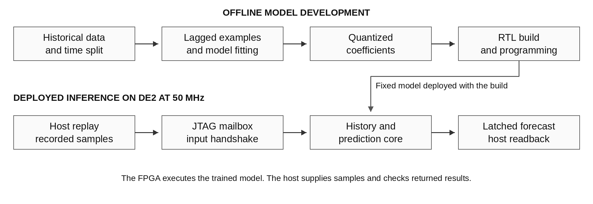
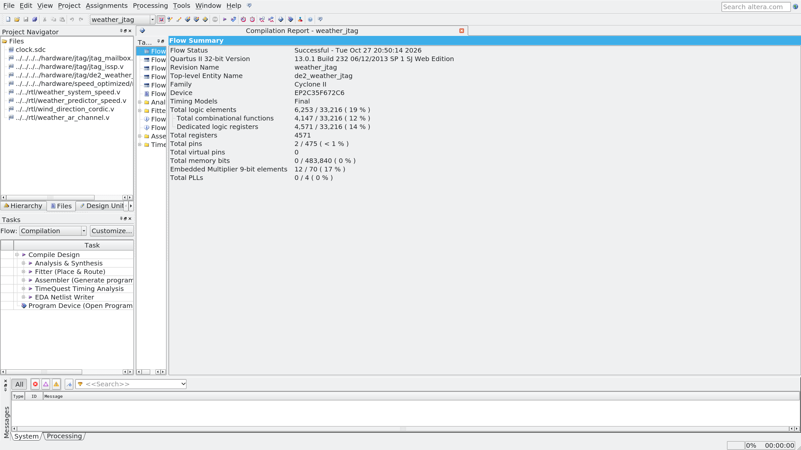
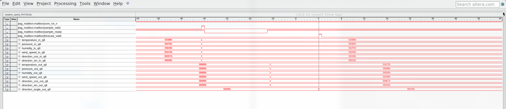
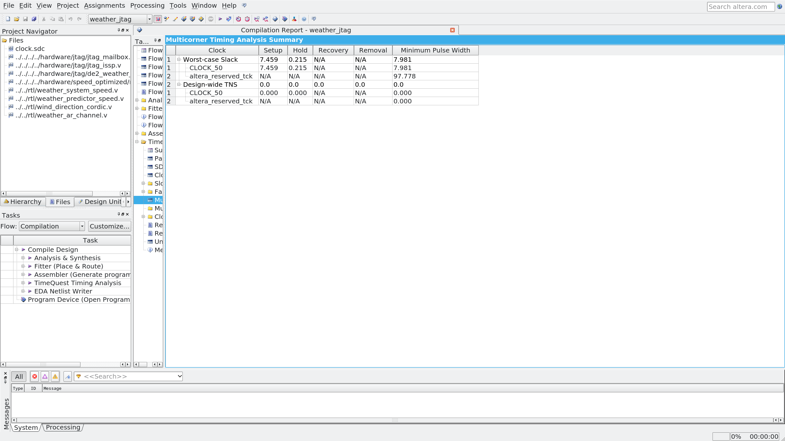
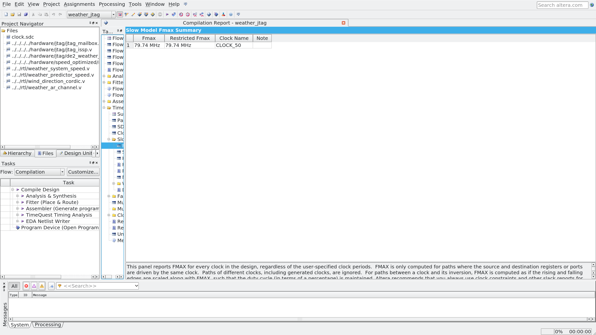

# FPGA implementation of a weather forecasting accelerator

Parallel inference and verification on Cyclone II  
CE436 Discrete Time Signal Processing and Applications  
2 November 2026

## Abstract

A fixed-point weather forecasting accelerator was implemented on the DE2 board using a Cyclone II EP2C35F672C6 FPGA. The project began with a three-parameter temperature predictor fitted by ordinary least squares and was extended to forecast temperature, surface pressure, relative humidity, wind speed, and wind direction three hours ahead. The current design uses six parallel arithmetic channels with seven historical lags per channel. Wind direction is predicted through cosine and sine components and reconstructed by an iterative CORDIC unit. Models are trained offline and deployed as fixed coefficients. On 8,757 test examples from 2025, the weather model achieved mean absolute errors of 0.507906 °C for temperature, 0.034600 kPa for pressure, 2.614292 percentage points for humidity, and 0.566878 m/s for wind speed. Direction error was 18.084598° on the defined non-calm subset using ideal angle decoding of quantized components. The complete RTL has a documented latency of 40 cycles at 50 MHz and accepts eligible frames at intervals of 23 cycles. Predictor-core timing simulation checked 264 forecasts, and physical JTAG replay checked 104 forecasts from 128 inputs. Saved SignalTap data records a valid physical prediction transaction. The report presents the temperature prototype as the development starting point and evaluates the current parallel weather implementation.

## 1 Introduction

The objective is to implement a short-horizon environmental predictor in fixed-point hardware and verify the complete path from recorded observations to FPGA results. Inputs are hourly samples supplied in chronological order. The output estimates conditions three hours after the latest observation. That forecast horizon belongs to the data model; the circuit returns a result after a finite number of 50 MHz clock cycles.

The initial temperature-only predictor established the coefficient-training flow, history buffer, integer arithmetic rules, and reference-based verification. The current system extends that work to additional weather variables, a larger lag model, and wind-direction conversion. Figure 1 shows the boundary between offline training, the host interface, and deployed inference.

Figure 1. Offline coefficient fitting and the deployed inference path. The computer supplies recorded weather frames through a JTAG mailbox and reads completed forecasts from the FPGA.

The implementation evaluated here is the speed-oriented weather design. Six arithmetic lanes operate in parallel, one per scalar or direction component. The following sections explain the development from the temperature prototype, define the selected model and hardware, and report forecast quality and implementation checks. Resource figures include the JTAG board interface and exclude SignalTap instrumentation unless stated otherwise.

## 2 Development from the temperature prototype

The original predictor used the previous day's temperature at the target hour as an anchor. Two learned corrections represented the daily difference and the latest three-hour change, with a fitted bias. Its equation was T̂(t + 3) = T(t − 21) + a[T(t) − T(t − 24)] + b[T(t) − T(t − 3)] + c. Training ran offline; the pipelined FPGA core applied the quantized coefficients to accepted input samples.

The prototype made the numerical and verification problems small enough to inspect directly. A forecast depended on four temperature positions within a 25-sample history. Signed 16-bit Q8 samples, Q14 coefficients, floor scaling, and saturation defined the arithmetic contract. The speed pipeline produced a result five cycles after acceptance and could accept a new sample each cycle after warm-up.

The extension changed the prediction model as well as the number of outputs. Candidate models were evaluated using a chronological validation period. The selected weather models use seven lags for each channel, and temperature and humidity use ridge regularization. Wind direction required an angular representation and a separate reconstruction stage. Table 1 summarizes the changes in scope.

Table 1. Development from the temperature prototype to the current weather design

| Aspect | Temperature prototype | Current weather design |
| --- | --- | --- |
| Forecast quantities | Temperature | Temperature, pressure, humidity, wind speed, direction |
| Arithmetic channels | One | Six, including direction cosine and sine |
| Model | Three-parameter seasonal OLS | Seven-lag univariate autoregression per channel |
| Lag positions | 0, 3, 21, 24 | 0, 1, 3, 6, 12, 21, 24 |
| Sample format | Signed 16-bit Q8 | Signed 18-bit Q8 |
| Product and accumulator | 33-bit products, 35-bit sum | 36-bit products, 48-bit sum |
| Full latency at 50 MHz | 5 cycles, 100 ns | 40 cycles, 0.80 µs |
| Eligible-frame initiation interval | 1 cycle | 23 cycles |
| Temperature test MAE | 0.538017 °C | 0.507906 °C |

The hourly input cadence, three-hour target horizon, and 25-frame history requirement were retained. The numerical rules and reference-checking approach were extended to the wider datapath and additional channels. The weather design is therefore a model and system extension of the prototype. It is not obtained by sending humidity or pressure through the unchanged three-parameter temperature equation.

The original fixed-point temperature MAE was 0.538017 °C over 8,757 test forecasts [1]. The current temperature-channel MAE is 0.507906 °C [2]. That comparison describes the change in the evaluated model. Parallel hardware scheduling does not itself improve prediction accuracy.

## 3 Forecast model and evaluation

### 3.1 Weather observations and time split

The weather dataset contains NASA POWER hourly T2M, PS, RH2M, WS10M, and WD10M values for Ho Chi Minh City at latitude 10.8231° N and longitude 106.6297° E, covering 2021 through 2025 in UTC. Pressure is expressed in kPa, humidity in percent, wind speed in m/s, and direction in degrees. NASA POWER provides gridded environmental data, so the reported errors should be interpreted for this dataset and location.

The evaluation separates training, validation, and test periods by time. Training target timestamps end before 1 January 2024. Validation uses 2024 inputs with targets before 2025. Test inputs belong to 2025, and examples whose targets fall beyond the available data are excluded. The resulting counts are 26,253 training examples, 8,781 validation examples, and 8,757 test examples. Each example requires 25 consecutive valid history samples. Missing observations are not silently interpolated.

Model candidates are compared on validation error. The selected coefficients are then frozen before test evaluation. This separation prevents the test period from influencing coefficient fitting or model selection. The saved temperature model has the same three hour horizon and a training target cutoff of 1 January 2024.

### 3.2 Selected autoregressions

The weather model selection evaluates persistence, the previous day baseline, the seasonal three-parameter model, and seven-lag autoregressions with several ridge penalties. The selected models are univariate autoregressions using lags 0, 1, 3, 6, 12, 21, and 24. Each channel follows Equation (1).

$$
\widehat x(t+3)=\beta_x+\sum_{k=0}^{6}w_{x,k}x(t-\ell_k),\qquad \ell=[0,1,3,6,12,21,24].
$$

Temperature and humidity select ridge penalty 1. Pressure, wind speed, and the direction component pair select penalty 0. These selections are the best candidates within the evaluated set according to validation error. The exact floating-point and integer coefficients are retained in the weather model record [2].

The host converts direction angles into cosine and sine before transmitting the inputs. The FPGA predicts these components and reconstructs the output angle using CORDIC. Angles are wrapped to the range from 0° inclusive to 360° exclusive. A zero predicted vector has an undefined direction flag.

### 3.3 Error measures

Persistence predicts that the future value will equal the latest observation. The diurnal baseline uses the previous day's observation at the target hour. For a forecast at time t + 3, the previous day target hour is t − 21. These baselines test whether the fitted model improves on simple temporal assumptions.

For N predictions, Equations (2) and (3) define mean absolute error and root mean square error.

$$
\mathrm{MAE}=\frac{1}{N}\sum_{i=1}^{N}|\widehat y_i-y_i|.
$$

$$
\mathrm{RMSE}=\sqrt{\frac{1}{N}\sum_{i=1}^{N}(\widehat y_i-y_i)^2}.
$$

Both metrics retain the unit of the target variable. Wind direction uses circular angular distance, which treats 359° and 1° as 2° apart. Direction scores include targets whose wind speed is at least 0.5 m/s. This threshold is a project evaluation choice.

Forecast error, fixed point approximation error, and hardware agreement answer different questions. Forecast error compares a prediction with a future observation. Approximation error compares fixed point inference with floating point inference. Hardware agreement compares RTL or FPGA output with the fixed point reference for the same inputs.

## 4 Parallel weather hardware

### 4.1 Arithmetic and scheduling

The top-level weather_system_speed module contains the parallel prediction core and wind_direction_cordic. The core accepts six simultaneous signed 18-bit Q8 inputs: temperature, pressure, humidity, wind speed, direction cosine, and direction sine. Coefficients are static signed 18-bit Q14 constants, biases are signed 32-bit Q8 values, full products have 36 bits, and accumulators have 48 bits.

Each arithmetic lane reuses its multiplier across that channel's seven terms. Parallel operation therefore applies across channels. The design does not compute all 42 products in a single cycle. The lane shifts its 25-entry history only when sample_valid and sample_ready are both high at an accepting rising edge. The first 24 accepted frames fill history; frame 25 is the first eligible forecast input.

Products and the aligned bias are added before scale reduction. The final arithmetic shift floors negative fractional values. Humidity is limited to 0 through 100%, wind speed to nonnegative values, and direction components to −1 through 1; remaining overflow saturates to the signed 18-bit range. The direction angle uses unsigned 18-bit degrees with eight fractional bits. A zero predicted component pair emits an undefined-direction flag.

The scalar core outputs are captured while the direction unit reconstructs the angle. They remain aligned with the final forecast_valid event. Full-system latency, measured from input acceptance to the visible complete output under the RTL post-edge convention, is 40 cycles, or 0.80 µs. The sustained accepted-frame interval after warm-up is 23 cycles. There is no output backpressure; the consumer must capture each valid result. Active-low synchronous reset cancels pending work and requires a fresh history window.

### 4.2 Host interface

Quartus In-System Sources and Probes provides a 128-bit source word and 256-bit probe word through the board's USB-Blaster connection. A mailbox stages one input frame, commits it with a request toggle, and acknowledges completion. Source values are synchronized to CLOCK_50, and the mailbox waits additional settling clocks before capturing the held payload. The host holds payload and request until acknowledgement and then checks a stable probe word.

The mailbox preserves the last completed forecast for slow host readback. It exposes accepted-frame and forecast counters, direction validity, and a design signature. Warm-up inputs are acknowledged without a forecast. After warm-up, the reply follows capture of the complete prediction. JTAG reset clears history eligibility, counters, and the retained result.

The replay script selects weather_speed and verifies the design identity before transmitting vectors. Results appear in the host output, saved CSV, or the In-System Sources and Probes Editor. The implementation has no LED, seven-segment, or LCD forecast display. Its physical demonstration uses recorded inputs. UART wrappers exist in the repository, but their physical operation has not been verified [7].

## 5 Verification procedure

SystemVerilog tests instantiate the production weather RTL and compare accepted-frame predictions with a C++ fixed-point reference through DPI-C. The scoreboard checks result values, validity, transaction order, and the expected schedule. Directed and random traffic exercise invalid gaps, input backpressure, signed extremes, range limits, and reset during processing. The weather speed regression accepted 1,200 frames, checked 1,124 forecasts, and accounted for four pending results canceled by reset [3]. History warm-up is repeated after each reset.

Functional netlist replay checks mapped logic using vendor simulation atoms. TimeQuest evaluates fitted timing under the declared constraints. ModelSim-Altera Starter Edition 10.1d runs the predictor-core timing netlist with maximum SDF delays at a 20 ns period. The accepted weather speed run supplied 288 inputs and checked 264 forecasts, with completed delay annotation and no reported timing violations [4]. This timing simulation covers the predictor core; a full SDF simulation of the proprietary JTAG transport is outside the claim.

The mailbox integration tests exercise 128 inputs and 104 forecasts, duplicate-request protection, reset cancellation, and a fresh 25-frame warm-up. Separate host tests mock the JTAG API and corrupt replies to verify mismatch detection. Their results establish checker behavior and are kept separate from physical evidence.

CORDIC verification checks angle conversion independently from forecast quality. Exhaustive conversion testing covered 263,169 integer component pairs, with maximum circular conversion error 0.005635°. Physical comparison permits five raw Q8 degree counts, equivalent to 0.01953125°, with the correct direction-defined flag.

## 6 Results

### 6.1 Forecast accuracy

Table 2 reports the weather evaluation using the selected coefficients [2]. Scalar targets use 8,757 examples; direction uses the non-calm subset described below.

Table 2. Weather model accuracy and baseline mean absolute errors on the test period

| Target and unit | Fixed point MAE | Fixed point RMSE | Persistence MAE | Previous day MAE |
| --- | --- | --- | --- | --- |
| Temperature in °C | 0.507906 | 0.730939 | 2.080369 | 0.832280 |
| Pressure in kPa | 0.034600 | 0.044638 | 0.135167 | 0.085775 |
| Relative humidity in % | 2.614292 | 3.685767 | 8.831186 | 3.804237 |
| Wind speed in m/s | 0.566878 | 0.750218 | 0.830494 | 0.891217 |
| Wind direction in degrees | 18.084598 | 30.201056 | 21.423810 | 35.292273 |

Direction results use 8,593 non-calm test targets and floating point atan2 applied to the quantized predicted components. They therefore describe the selected fixed point component model with ideal angle decoding. CORDIC approximation is checked separately. Exhaustive conversion testing covered 263,169 integer cosine and sine pairs, with a maximum circular conversion error of 0.005635°. The physical replay permits an angle difference of five Q8 degree units, equivalent to 0.01953125°.

The temperature result is consistent with the model progression in Table 1. All metrics remain specific to the retained location and chronological test period.

### 6.2 FPGA implementation

The board project targets EP2C35F672C6 with CLOCK_50 constrained to 20 ns. Application pins are CLOCK_50 = N2 and KEY0_N = G26. JTAG uses dedicated device infrastructure. Table 3 records the uninstrumented weather speed JTAG fit, including the prediction system and mailbox [3].

Table 3. Implementation results for the weather speed JTAG design

| Quantity | Result |
| --- | --- |
| Logic elements | 6253 |
| Registers | 4571 |
| Mapped memory bits | 0 |
| 9-bit multiplier elements | 12 |
| Estimated Fmax | 79.74 MHz |
| Setup slack at 50 MHz | 7.459 ns |
| Hold slack | 0.215 ns |
| Physical test clock | 50 MHz |
| Documented full latency | 40 cycles, 0.80 µs |
| Sustained eligible-frame interval | 23 cycles |

Twelve 9-bit multiplier elements correspond to six full 18 by 18 multiplier resources on this target. Zero mapped memory bits does not imply an absence of stored history; storage can map to registers and logic. Fmax is a fitted static timing estimate. Physical testing used 50 MHz and did not sweep the board clock to establish a measured frequency limit. SignalTap adds acquisition circuitry, so its instrumented fit is kept outside Table 3.

Figure 2 places the native Quartus compilation record beside the implementation figures in Table 3. The project title, target device, successful flow status, and resource counts are visible in the application itself. The timing and Fmax application views are reproduced at larger size in Appendix C.

Figure 2. Detail of the original Quartus Flow Summary for weather_jtag. The completed fit reports EP2C35F672C6, 6,253 logic elements, 4,571 registers, and 12 nine-bit multiplier elements. This is the uninstrumented implementation; the full saved screenshot is retained with the project evidence.

### 6.3 Physical replay and waveform evidence

Physical verification was performed on 28 October 2026. USB-Blaster identified an EP2C35 device with JTAG ID 0x020B40DD. The weather speed SOF was programmed, the host checked the variant identity, and the replay script reset the design through JTAG before sending vectors.

The uninstrumented design accepted 128 input frames and returned 104 checked forecasts [5]. The difference is the 24-frame history fill. All six scalar and component outputs agreed bit for bit with the fixed-point reference, and direction angle and validity passed the specified tolerance check. The instrumented weather speed build passed a separate replay with the same counts. These tests verify the programmed implementation for the supplied transactions; historical forecast quality is evaluated separately in Table 2.

SignalTap captured 512 samples at the 50 MHz acquisition clock. The accepted input occurs at capture index 215, and forecast_valid occurs at trigger index 256 [6]. Their raw separation is 41 sampled intervals. The RTL scoreboard observes updated registers after the accepting edge, while SignalTap samples at its acquisition edge; the documented post-edge RTL latency is 40 cycles under that convention.

Figure 3 reproduces the native SignalTap application capture from the physical session. The complete prediction becomes valid at the trigger. Output bus transitions when forecast_valid is low are not additional predictions. The original acquisition and decoded samples are retained in [6]; Appendix C provides a larger application view and explains the displayed bus values.

Figure 3. Original SignalTap waveform from the instrumented weather speed FPGA. The signal names, valid and ready handshake, forecast-valid trigger, and hexadecimal bus values are recorded by the application. At completion, temperature_out_q8 is 01A72, equivalent to 26.4453125 °C, and direction_angle_out_q8 is 00570, equivalent to 5.4375°. The larger view is Figure C4.

## 7 Discussion

The extension adds both output coverage and implementation work. Temperature, pressure, humidity, and wind speed use separate lag models; direction adds two component predictions and angle reconstruction. The selected models are univariate, so each channel uses its own past values. Additional weather channels do not supply cross-variable predictors to the current temperature model.

The chronological test results show a lower temperature MAE than the original three-parameter prototype and lower errors than the listed simple baselines for the reported weather targets. The comparison is specific to the evaluated candidates and test period. Direction error uses ideal atan2 decoding of quantized components; the separate CORDIC checks characterize the hardware conversion approximation.

At 50 MHz, computation finishes long before another hourly observation is required. The parallel implementation demonstrates a complete, verifiable hardware inference path; it does not establish a need for such throughput in hourly forecasting. JTAG replay is slower than the arithmetic core and is not a measurement of sustained core throughput.

The evidence covers fixed coefficients and recorded inputs at one location. It does not establish live sensor operation, electrical power consumption, a measured maximum physical clock frequency, or accuracy at other sites. Precipitation probability is outside the implemented targets. These limits leave the main result intact: the selected weather predictor has been mapped to fixed-point hardware and checked through simulation, timing analysis, and physical replay.

## 8 Conclusion

The project progressed from a three-parameter temperature predictor to a six-channel parallel weather forecasting accelerator. The current implementation retains hourly inputs, a three-hour target horizon, and accepted-sample history control, while introducing seven-lag models, wider arithmetic, and CORDIC direction reconstruction.

The weather speed design achieved the forecast errors in Table 2, a documented 40-cycle latency at 50 MHz, and a successful physical replay of 128 frames and 104 forecasts. The fitted JTAG build used 6,253 logic elements and 12 nine-bit multiplier elements, with positive setup and hold margins at the test clock. The retained source files and native SignalTap data support reproduction and review of this implementation.

## References

The numbered records identify the data models, numerical evaluation, and implementation evidence cited in this report.

[1] [Original temperature model](../../../software/models_cpp/model.json), [temperature metrics](../temperature_metrics.csv), and [temperature numerical error](../temperature_numerical_error.csv).

[2] [Weather model and deployed coefficients](../../../versions/weather_v2/models/model.json), [validation candidates](../../../versions/weather_v2/reports/validation_candidates.csv), and [test metrics](../../../versions/weather_v2/reports/metrics.csv).

[3] [Implementation and verification report](../IMPLEMENTATION_REPORT.md) and [JTAG fitted implementation report](../JTAG_IMPLEMENTATION_REPORT.md).

[4] [Weather speed timing simulation manifest](../weather_speed_modelsim_timing.json).

[5] [Weather speed physical JTAG replay](../physical_jtag_weather_speed.csv).

[6] [SignalTap capture check](../defense_session/SIGNALTAP_CAPTURE_CHECK.json), [weather speed native capture](../defense_session/signaltap/weather_speed.stp), and [decoded samples](../defense_session/signaltap/weather_speed_decoded.csv).

[7] [Native weather speed SignalTap screenshot](../defense_session/screenshots/weather_speed_signaltap_detail.png) and [JTAG protocol](../../../hardware/jtag/README.md).

[8] [Saved physical-session archive](../defense_evidence_2026-10-28.tar.gz) and [evidence checksums](../defense_session/SAVED_EVIDENCE_SHA256.json).

## Appendix A Deployed coefficients

The following table gives the deployed signed integer coefficients from [2]. Weight order is lag 0, 1, 3, 6, 12, 21, and 24. Divide each weight by 16384 to recover its quantized real coefficient, and divide each bias by 256. These are channel-specific constants; the prototype coefficients a, b, and c are not used by the current weather datapath.

Table A1. Deployed weather coefficient integers

| Channel | Seven Q14 weights in lag order | Q8 bias |
| --- | --- | --- |
| Temperature | 20035, -9335, 1621, -205, 15, 13908, -10382 | 310 |
| Pressure | 29672, -20298, 5187, 668, -513, 11566, -10423 | 823 |
| Humidity | 17332, -6498, 903, -342, 251, 13962, -9701 | 602 |
| Wind speed | 23040, -13956, 1683, 189, 184, 8822, -5682 | 89 |
| Direction cosine | 19607, -8905, -237, -30, 1146, 5945, -2664 | -5 |
| Direction sine | 19059, -8110, -140, 1183, 1368, 4266, -2003 | 0 |

## Appendix B Reproduction

Open versions/weather_v2/quartus/de2_jtag_speed/weather_jtag.qpf for the board deployment. Its programming file is output_files/weather_jtag.sof in the same project directory. Core-only projects use a different measurement boundary and should not be assumed to carry the board pin map.

For a live demonstration, power the original DE2, connect USB-Blaster, program the weather speed SOF, and select weather_speed in scripts/replay_jtag.tcl. The script resets the design, checks its identity, and compares returned frames against the golden vectors. The request must remain stable until its acknowledgement. Manual writes from the Sources and Probes Editor should be performed outside the automated replay session.

Power cycling clears the SRAM configuration, so the SOF must be programmed again for a later demonstration. Saved STP acquisitions, decoded CSVs, and screenshots remain available offline. The evidence archive [8] contains the earlier physical session, including other historical variants. The weather_speed records cited here identify the implementation evaluated in this report.

## Appendix C Native implementation screenshots

#### Quartus compilation and fitted resources

Figure C1. Native Quartus compilation report for the weather speed JTAG build. The enlarged view shows the successful flow, Cyclone II EP2C35F672C6 target, weather speed source files, 6,253 logic elements, 4,571 registers, and 12 nine-bit multiplier elements. The screenshot records the uninstrumented build and supports the implementation resource figures.

The image is a detail view of the saved application screenshot. The original remains at docs/reports/defense_session/screenshots/weather_speed_flow_summary.png. Its compilation timestamp is 27 October 2026; physical verification followed on 28 October. These are separate stages of the implementation.

#### Quartus timing analysis

Figure C2. Native TimeQuest multicorner timing summary. CLOCK_50 has positive setup slack of 7.459 ns and hold slack of 0.215 ns, with zero reported total negative slack for those checks. The image is an enlarged detail of the saved application screenshot.

Figure C3. Native slow-model Fmax summary for the same weather speed JTAG build. The estimated Fmax is 79.74 MHz for CLOCK_50. Physical replay used 50 MHz; this timing estimate is not a measured maximum board frequency. Both original screenshots remain in docs/reports/defense_session/screenshots.

#### Physical SignalTap waveform

Figure C4. Saved native SignalTap waveform from the instrumented weather speed design, acquired during the physical FPGA session. The screenshot shows the input valid and ready signals, the final forecast_valid event at the trigger, and the input and output buses. The original signal names and bus values remain visible in the application capture.

The complete physical capture is retained as docs/reports/defense_session/signaltap/weather_speed.stp. At the forecast-valid event, the temperature bus reads hexadecimal 01A72, which is raw 6770, or 26.4453125 °C in Q8. The angle bus reads hexadecimal 00570, or 5.4375° in unsigned Q8 degrees. These decoded values explain how to read the screenshot; their agreement with the reference is checked by the saved replay and capture checks.

The input acceptance and final forecast-valid event are separated by 41 recorded acquisition intervals. The documented RTL latency is 40 cycles under its post-edge observation convention. The native waveform preserves the acquisition convention and must be read together with that explanation. SignalTap instrumentation changes the fitted design, so the resource and Fmax screenshots above describe the separate uninstrumented build.
